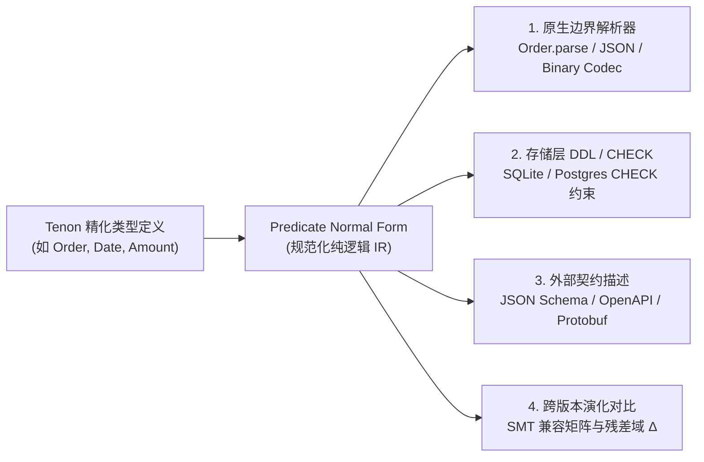

# 02 — 强约束精化类型系统设计（Refinement & Dependent-Lite Types）

> 本章定义 Tenon 的核心类型约束能力：如何以极低的心智负担表达正数金额、奇偶数、格式化验证值、跨字段结构体不变量（如合法公历 `Date`）、集合与状态机不变量，并在编译期安全消除冗余检查、在外部边界自动派生校验器与存储约束。

---

## 1. 设计原则

1. **精化是一等类型，而非注释或断言宏**：精化谓词参与类型检查、子类型判定、泛型约束、编解码派生与跨版本兼容性推导。
2. **Parse, Don't Validate（边界构造，内部信任）**：
   - 未验证的原始值（`Int`、`Text`、JSON 字节、SQL 行）**不能**隐式进入精化类型，必须经过**静态证明**或**显式边界解析（返回 `Result[T, ValidationError]`）**。
   - 一旦构造成功，值在内部流转期间**自动携带其谓词事实**，下游函数无需重复写防御性 `if` 判断。
3. **无别名污染（MVS 护航）**：由于 Tenon 默认采用可变值语义（见第 05 章），精化值不存在“隐蔽的外部可变别名”，因此不需要像 `loom-lang` 那样引入复杂的草案发布（draft publication）或别名干扰分析来防止不变量被悄悄破坏。
4. **严格分离纯度与求值确定性**：所有出现在类型谓词中的表达式与辅助函数必须是 **`pure` 且有界/终止（total/terminating）** 的，禁止 I/O、随机数、全局时钟或非确定性浮点行为，确保类型含义在编译期、运行时、数据库 `CHECK` 与跨版本推导中完全一致。

---

## 2. 六类核心约束表达模式

### 2.1 标量范围与正数（Interval Refinements）

最常见的业务不变量，直接交由 **L0 区间求解器**在 <1ms 内静态处理：

```tenon
pub type PositiveInt = Int64 where self > 0
pub type NonNegInt   = Int64 where self >= 0
pub type AmountCents = Int64 where self > 0 && self <= 10_000_000_000  // 金额（分）
pub type Percentage  = Int32 where 0 <= self && self <= 100
pub type UserPort    = UInt16 where 1024 <= self && self <= 65535
pub type NonZero[T: IntLike] = T where self != 0

// 除零在类型层彻底消灭
pub pure fn div_exact(a: Int64, b: NonZero[Int64]) -> Int64 {
    a / b  // 编译期已证明 b != 0，无需运行时除零检查
}

// 两个正金额相加：L0 自动推导出结果 > 0（在检查无溢出或使用安全上限下）
pub pure fn merge_amounts(a: AmountCents, b: AmountCents) -> PositiveInt
    requires a + b <= Int64.MAX
{
    a + b  // 无需重新构造/校验，零开销通过
}
```

### 2.2 数论同余与步长约束（Congruence & Modular Refinements）

普通编程语言几乎无法在类型系统表达“奇数/偶数/对齐偏移”，Tenon 的 L0 求解器原生内置**同余域（Congruence Domain: $x \equiv r \pmod m$）**：

```tenon
pub type Even = Int64 where self % 2 == 0
pub type Odd  = Int64 where self % 2 != 0
pub type Aligned[const N: USize where self > 0 && (self & (self - 1)) == 0] =
    USize where self % N == 0

// 同余代数自动闭合（L0 毫秒级证明，不调用 Z3）：
pub pure fn odd_plus_odd(a: Odd, b: Odd) -> Even       { a + b }   // 1 + 1 ≡ 0 (mod 2)
pub pure fn odd_times_odd(a: Odd, b: Odd) -> Odd       { a * b }   // 1 * 1 ≡ 1 (mod 2)
pub pure fn double_any(x: Int64) -> Even               { x * 2 }   // 2x ≡ 0 (mod 2)
pub pure fn next_odd(x: Even) -> Odd                   { x + 1 }

// 系统编程直接受益：对齐指针/偏移在编译期保证
pub fn read_page(offset: Aligned[4096]) -> Page { ... }
```

### 2.3 可验证值与格式化域类型（Validated Domain Values）

对于无法仅靠算术表达的格式约束（邮箱、手机号、SKU、正则、校验和如 Luhn/IBAN、合法 UTF-8 标识符），支持 **纯校验函数精化（Predicate-Backed Refinements）** 与 **自定义语义错误**：

```tenon
// 1. 内置可判定字符串/正则谓词（L0/L1 可静态校验字面量，运行时编译为 DFA）
pub type Email = Text where self.matches(r"^[a-zA-Z0-9._%+-]+@[a-zA-Z0-9.-]+\.[a-zA-Z]{2,}$")
                         && self.byte_len <= 254

// 2. 任意纯校验函数（可包含校验和、白名单、复杂规则）
pub pure fn luhn_valid(digits: Text) -> Bool { ... }

pub type CardNumber = Text
    where self.byte_len >= 13 && self.byte_len <= 19
       && self.is_ascii_digits()
       && luhn_valid(self)
    error InvalidCardError

// 字面量在编译期通过 CTFE 直接求值校验！
let admin: Email = "ops@example.com"     // 编译期求值通过，运行时零校验
// let bad: Email = "not-an-email"       // 编译期直接报错！

// 运行时输入走自动生成的 .parse() 边界
let user_mail: Result[Email, ValidationError] = Email.parse(req.body.email)
```

> **精化与 `newtype` 名义隔离的统一**：  
> `type AmountCents = Int64 where self > 0` 默认支持**安全弱化（Safe Widening）**回 `Int64`（方便参与普通运算）；如果需要防止把 `OrderId` 和 `UserId` 混传，使用名义包装 `distinct type OrderId = Int64 where self > 0`，禁止隐式弱化，须显式 `.raw()` 取出底层值。

### 2.4 跨字段依赖结构体不变量（Dependent Record Invariants）

这是业务建模中最关键、也是传统语言最无力的部分。以用户提出的 `Date` 为例：

```tenon
pub pure fn is_leap_year(year: Int) -> Bool {
    (year % 4 == 0 && year % 100 != 0) || (year % 400 == 0)
}

pub pure fn days_in_month(year: Int, month: Int where 1 <= self && self <= 12) -> Int
    ensures 28 <= result && result <= 31
{
    match month {
        2 => if is_leap_year(year) { 29 } else { 28 },
        4 | 6 | 9 | 11 => 30,
        _ => 31,
    }
}

// 写法 A：字段级依赖精化（按字段拓扑序引用前置字段）
pub struct Date {
    year:  Int where 1 <= self && self <= 9999,
    month: Int where 1 <= self && self <= 12,
    day:   Int where 1 <= self && self <= days_in_month(year, month),
}

// 写法 B：结构级联合不变量（适用于多字段对称关系或复杂跨字段规则）
pub struct DateRange {
    start: Date,
    end:   Date,
    where self.start <= self.end,
}

// 更复杂的金融业务不变量：复式记账凭证必须借贷平衡且至少两条分录
pub struct JournalEntry {
    lines: NonEmptyList[PostingLine],
    where sum(self.lines, |l| l.debit) == sum(self.lines, |l| l.credit)
       && self.lines.len >= 2,
}
```

#### 编译期推导实战：`Date` 如何同时做到极速和精准？

1. **常量构造**：`Date { year: 2024, month: 2, day: 29 }` → L0 直接局部求值 `days_in_month(2024, 2) = 29`，证明 `1 <= 29 <= 29`，编译期零开销通过。
2. **非法常量**：`Date { year: 2023, month: 2, day: 29 }` → L0 算出 `days_in_month(2023, 2) = 28`，直接给出编译错误：
   ```text
   error[E0412]: refinement constraint not satisfied for field `day` of `Date`
     --> app.tn:12:35
      |
   12 | let d = Date { year: 2023, month: 2, day: 29 }
      |                                          ^^^ expected `1 <= day && day <= days_in_month(year, month)`
      |
      = note: evaluated `days_in_month(2023, 2) == 28`
      = note: `29 <= 28` is false
   ```
3. **动态输入构造**：
   - `Date { year: y, month: m, day: d }` 若无法静态证明合法，**编译期直接拒绝**，并提示使用 `Date.parse(y, m, d)`（返回 `Result[Date, ValidationError]`）。
   - 如果调用处前方已经有流敏感校验，例如：
     ```tenon
     if 1 <= y && y <= 9999 && 1 <= m && m <= 12 && 1 <= d && d <= 28 {
         // 编译器利用 days_in_month 的 ensures (result >= 28)
         // 自动证明 d <= 28 <= days_in_month(y, m)！
         let valid = Date { year: y, month: m, day: d } // 静态通过，零重复检查！
     }
     ```
   - 这种**“只要 1..=28 号，无论哪年哪月都静态合法”**的推导，完全依赖 `days_in_month` 的 `ensures 28 <= result`，根本不需要展开函数体！

### 2.5 原子多字段变更：`mutate` 块解决“临时破坏不变量”难题

对于跨字段约束结构体，逐字段修改往往会在中间瞬间破坏不变量（例如把 `2024-02-29` 改成年份 `2023` 再把日期改成 `28`，或在 `DateRange` 中把 `start` 和 `end` 同时后移 10 天）。

Tenon 提供轻量级 **`mutate` 原子不变量块**：

```tenon
pub fn shift_range(inout r: DateRange, delta_days: Int) {
    // 禁止单独写 r.start = ... 导致中间态 start > end
    mutate r {
        // 在块内 r 被解封为未精化视图（不能在块内把 r 传给要求 DateRange 的函数）
        r.start = add_days(r.start, delta_days)
        r.end   = add_days(r.end, delta_days)
    } // 块退出点（含任何提前 return/错误路径）强制静态证明 r.start <= r.end！
}
```

**为什么这在 Tenon 里极其干净，而在 Loom 里非常痛苦？**
- 因为 Tenon 采用 **MVS（无共享可变别名）**，`inout r` 是对 `r` 的独占可变访问！
- 在 `mutate r { ... }` 期间，不可能存在任何其他引用或闭包能观察到 `r` 的中间半成品状态！
- 如果 `mutate` 块内发生错误退出（`?`），编译器要么要求恢复不变量，要么自动采用事务拷贝回滚（对小值仅是栈上寄存器拷贝，零堆分配开销）。

### 2.6 容器与状态机精化

```tenon
// 容器长度与内容精化
pub type NonEmpty[T]      = List[T] where self.len > 0
pub type BoundedText[const MAX: USize] = Text where self.byte_len <= MAX
pub type ValidMatrix[const R: USize, const C: USize] =
    List[List[Float64] where self.len == C] where self.len == R

// 无越界安全索引（流敏感 + 精化）
pub pure fn first[T](xs: NonEmpty[T]) -> T {
    xs[0]  // 静态证明 0 < xs.len，消除边界检查
}

// 代数数据类型 + 精化构成强类型状态机
pub enum OrderStatus {
    Draft,
    Submitted { amount: AmountCents, submitted_at: Date },
    Paid      { amount: AmountCents, paid_amount: AmountCents, paid_at: Date }
        where paid_amount == amount,
    Refunded  { amount: AmountCents, refunded_amount: AmountCents }
        where refunded_amount <= amount,
}
```

---

## 3. 精化子类型格与自动边界派生（Single Source of Truth）

### 3.1 精化子类型格（Refinement Subtyping Lattice）

对于同一基础类型 $B$ 上的两个精化类型 $T_1 = \{v : B \mid P_1(v)\}$ 与 $T_2 = \{v : B \mid P_2(v)\}$，定义语义子类型关系：

$$T_1 <: T_2 \iff \forall v : B.\; P_1(v) \implies P_2(v)$$

- **编译期自动弱化（Safe Widening）**：若求解器证明 $P_1 \implies P_2$（例如 `AmountCents <: PositiveInt <: NonNegInt <: Int64`），`T1` 可直接作为 `T2` 使用，**零运行时转换开销**。
- **编译期交集与收紧（Flow-Sensitive Narrowing）**：在 `if x > 0 { ... }` 分支内，局部类型环境 $\Gamma$ 自动叠加事实 `x > 0`，形成交集精化 `{v | P(v) ∧ v > 0}`。
- **跨版本兼容性复用同一套子类型格**：第 04 章的版本演化引擎直接复用这套 $P_{V1} \implies P_{V2}$ 判定器来推导升级/降级兼容性！

### 3.2 单源真相（Single Source of Truth）：从精化类型自动派生一切边界

传统工程中，“金额 > 0” 或 “Date 合法” 要写 5 遍：前端表单校验、API JSON Schema、服务端 DTO、领域模型、数据库 `CHECK` 约束——极易漂移。

Tenon 通过**编译期只读 Schema 反射 + 谓词规范化 IR（Predicate Normal Form）**，从一份类型定义自动派生四类边界产物：



- **精确结构化校验错误**：`Date.parse` / `Order.from_json` 自动按字段拓扑序执行校验，失败时返回带完整字段路径与失败谓词名的 `ValidationError`（支持一次性收集全部字段错误或短路失败）。
- **可翻译 SQL `CHECK` 的严格边界**：与 Loom `std.storage` 保持同样的工程诚实度——只把可精确等价映射的算术/布尔/比较/有限条件谓词（包括可展开的有限纯函数如 `days_in_month`！）翻译为 SQL `CHECK`，遇到不可翻译的复杂自定义函数（如 `luhn_valid`）时**显式标注为“应用边界强制、DB 仅保基础类型”**，绝不静默丢弃约束。

---

## 4. 诚实的边界：这套类型系统刻意不做什么？

1. **不做全谱依赖类型里的“类型级任意图灵计算”**：不追求把 Lean/Idris 的全部证明战术搬进日常类型表达式（避免类型检查不可判定或报错如天书）；复杂归纳命题归入第 03 章的 L2 `lemma` 层。
2. **不做不可追踪的运行时动态监控（Contracts-as-Proxies）**：绝不通过偷偷插入隐蔽代理对象去“监视”字段修改，确保零隐藏性能陷阱。
3. **浮点数精化遵循严格 IEEE 754 语义**：区分 `NaN`、`-0.0` 与精度舍入；金额等精确场景推荐使用定点数 `Decimal` 或整数分 `AmountCents`（避免浮点误差破坏跨系统一致性）。
