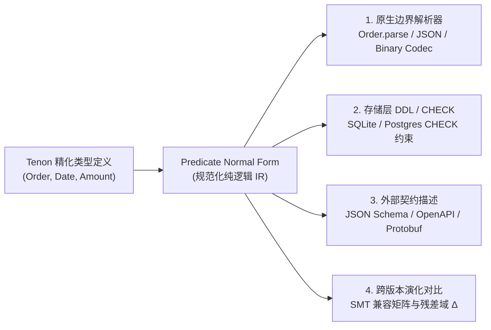

# 02 — 强约束精化类型系统设计（Refinement & Dependent-Lite Types）

> 本章定义 Tenon 的核心类型约束能力（严格采用 [ADR-0001 (D05 & D12)](adr/0001-architecture-decisions.md) 定稿的 **`loom/Go` 简洁语法** 与 **checked 固定宽度整数 + Fail-Closed 语义**）：如何以极低的心智负担表达正数金额、奇偶数、格式化验证值、跨字段依赖记录不变量（如合法公历 `Date`）、集合与状态机不变量，并在编译期安全消除冗余检查、在外部边界自动派生校验器与存储约束。

---

## 1. 设计原则

1. **精化是一等类型，而非注释或断言宏**：精化谓词参与类型检查、子类型判定、泛型约束、编解码派生与跨版本兼容性推导。
2. **Parse, Don't Validate（边界构造，内部信任）**：
   - 未验证的原始值（`Int`、`Text`、JSON 字节、SQL 行）**不能**隐式进入精化类型，必须经过**静态证明**或**显式边界解析（返回 `Result[T, ValidationError]`）**。
   - 一旦构造成功，值在内部流转期间**自动携带其谓词事实**，下游函数无需重复写防御性 `if` 判断。
3. **无别名污染（MVS 护航）**：由于 Tenon 默认采用可变值语义（[ADR-0001 D03](adr/0001-architecture-decisions.md)），精化值不存在隐蔽的外部可变别名，彻底告别草案发布（draft publication）与别名干扰分析。
4. **固定宽度 `checked` 算术 + 确定性纯谓词**：所有出现在类型谓词中的表达式与辅助函数必须是 **`pure` 且有界/终止**的；算术默认执行溢出检查并在 L0/L1 证明安全时零开销消除，确保类型含义在编译期、运行时、数据库 `CHECK` 与跨版本推导中完全一致。

---

## 2. 六类核心约束表达模式

### 2.1 标量范围与正数（Interval Refinements）

最常见的业务不变量，直接交由 **L0 区间求解器**在 <1ms 内静态处理：

```tenon
pub type PositiveInt = Int64 where self > 0
pub type NonNegInt   = Int64 where self >= 0
pub type AmountCents = Int64 where self > 0 && self <= 10_000_000_000  // 金额（分）
pub type Percentage  = Int32 where 0 <= self && self <= 100
pub type UserPort    = UInt16 where 1024 <= self && self <= 65535
pub type NonZero[T IntLike] = T where self != 0

// 除零在类型层彻底消灭
pub pure fn div_exact(a Int64, b NonZero[Int64]) Int64 {
    a / b  // 编译期已证明 b != 0，自动消除运行时除零检查
}

// 两个有界正金额相加：L0 区间域自动证明不会溢出 Int64 且结果 > 0，零开销通过！
pub pure fn merge_amounts(a AmountCents, b AmountCents) PositiveInt {
    a + b
}
```

### 2.2 数论同余与步长约束（Congruence & Modular Refinements）

Tenon 的 L0 求解器原生内置**同余域（Congruence Domain: $x \equiv r \pmod m$）**：

```tenon
pub type Even = Int64 where self % 2 == 0
pub type Odd  = Int64 where self % 2 != 0
pub type Aligned[comptime N USize where self > 0 && (self & (self - 1)) == 0] =
    USize where self % N == 0

// 同余代数自动闭合（L0 毫秒级证明，不调用 Z3）：
pub pure fn odd_plus_odd(a Odd, b Odd) Even
    requires a + b >= Int64.MIN && a + b <= Int64.MAX
{
    a + b  // 1 + 1 ≡ 0 (mod 2)
}

pub pure fn odd_times_odd(a Odd, b Odd) Odd
    requires a * b >= Int64.MIN && a * b <= Int64.MAX
{
    a * b  // 1 * 1 ≡ 1 (mod 2)
}

pub pure fn next_odd(x Even) Odd
    requires x < Int64.MAX
{
    x + 1
}

// 系统编程直接受益：对齐偏移在编译期保证
pub fn read_page(offset Aligned[4096]) Page { ... }
```

### 2.3 可验证值与格式化域类型（Validated Domain Values）

支持**纯校验函数精化（Predicate-Backed Refinements）**与**自定义语义错误**：

```tenon
// 1. 内置可判定正则/字符串谓词（字面量在编译期 CTFE 校验，运行时编译为 DFA）
pub type Email = Text where self.matches(r"^[a-zA-Z0-9._%+-]+@[a-zA-Z0-9.-]+\.[a-zA-Z]{2,}$")
                         && self.byte_len <= 254

// 2. 任意纯校验函数（如校验和 Luhn / IBAN）
pub pure fn luhn_valid(digits Text) Bool { ... }

pub type CardNumber = Text
    where self.byte_len >= 13 && self.byte_len <= 19
       && self.is_ascii_digits()
       && luhn_valid(self)
    error InvalidCardError

// 字面量在编译期直接校验！
let admin Email = "ops@example.com"     // 编译期求值通过，运行时零校验
// let bad Email = "not-an-email"       // 编译期直接报错！

// 运行时输入走自动生成的 .parse() 边界
let user_mail Result[Email, ValidationError] = Email.parse(req.body.email)
```

> **精化与 `distinct` 名义隔离**：  
> `type AmountCents = Int64 where self > 0` 默认支持**安全弱化（Safe Widening）**回 `Int64`；如需防止 `OrderId` 与 `UserId` 混传，使用 `distinct type OrderId = Int64 where self > 0`，禁止隐式弱化，须显式 `.raw()` 取出底层值。

### 2.4 跨字段依赖记录不变量（Dependent Record Invariants）

以合法公历日期 `Date` 与账务凭证为例：

```tenon
pub pure fn is_leap_year(year Int) Bool {
    (year % 4 == 0 && year % 100 != 0) || (year % 400 == 0)
}

pub pure fn days_in_month(year Int, month Int where 1 <= self && self <= 12) Int
    ensures 28 <= result && result <= 31
{
    match month {
        2 => if is_leap_year(year) { 29 } else { 28 }
        4 | 6 | 9 | 11 => 30
        _ => 31
    }
}

// 写法 A：字段级依赖精化（按拓扑序引用前置字段）
pub record Date {
    year  Int where 1 <= self && self <= 9999
    month Int where 1 <= self && self <= 12
    day   Int where 1 <= self && self <= days_in_month(year, month)
}

// 写法 B：记录级联合不变量（适用于多字段对称关系）
pub record DateRange {
    start Date
    end   Date
    where self.start <= self.end
}

// 金融复式记账凭证：借贷必须平衡且至少两条分录
pub record JournalEntry {
    lines NonEmpty[PostingLine]
    where sum(self.lines, fn(l PostingLine) Int64 { l.debit })
       == sum(self.lines, fn(l PostingLine) Int64 { l.credit })
       && self.lines.len >= 2
}
```

#### 编译期推导实战：`Date` 如何同时做到极速和精准？

1. **常量构造**：`Date { year = 2024, month = 2, day = 29 }` → L0 局部求值 `days_in_month(2024, 2) = 29`，证明 `1 <= 29 <= 29`，零开销通过。
2. **非法常量**：`Date { year = 2023, month = 2, day = 29 }` → L0 算出 `days_in_month(2023, 2) = 28`，直接给出编译期反例：
   ```text
   error[E0412]: refinement constraint not satisfied for field `day` of `Date`
     --> app.tn:12:41
      |
   12 | let d = Date { year = 2023, month = 2, day = 29 }
      |                                              ^^ expected `1 <= day && day <= days_in_month(year, month)`
      |
      = note: evaluated `days_in_month(2023, 2) == 28`
      = note: `29 <= 28` is false
   ```
3. **流敏感动态构造**：
   ```tenon
   if 1 <= y && y <= 9999 && 1 <= m && m <= 12 && 1 <= d && d <= 28 {
       // 利用 days_in_month 的 ensures (result >= 28)，L0 自动证明 d <= 28 <= days_in_month(y, m)！
       let valid = Date { year = y, month = m, day = d } // 静态通过，零重复检查！
   }
   ```
   若输入无静态证明，直接构造 `Date { ... }` 会被编译期拒绝，提示使用自动派生的 `Date.parse(y, m, d)`（返回 `Result[Date, ValidationError]`）。

### 2.5 原子多字段变更：`mutate` 块

```tenon
pub fn shift_range(inout r DateRange, delta_days Int) {
    // 禁止单独改 r.start 造成中间非法态
    mutate r {
        // 块内 r 解封为未精化视图（且受无栈协程效应保护：禁止在 mutate 内 .await 挂起！）
        r.start = add_days(r.start, delta_days)
        r.end   = add_days(r.end, delta_days)
    } // 块退出点（含任何提前 return/错误路径）强制静态证明 r.start <= r.end！
}
```

因为默认 MVS 无共享可变别名，`inout r` 保证独占访问，块内中间状态绝对不会被任何外部别名或异步挂起观察到。

### 2.6 容器与状态机精化

```tenon
pub type NonEmpty[T]                   = List[T] where self.len > 0
pub type BoundedText[comptime MAX USize] = Text  where self.byte_len <= MAX
pub type ValidMatrix[comptime R USize, comptime C USize] =
    List[List[Float64] where self.len == C] where self.len == R

pub pure fn first[T](xs NonEmpty[T]) T {
    xs[0]  // L0 静态证明 0 < xs.len，消除边界检查
}

pub enum OrderStatus {
    Draft
    Submitted { amount AmountCents, submitted_at Date }
    Paid      { amount AmountCents, paid_amount AmountCents, paid_at Date }
        where paid_amount == amount
    Refunded  { amount AmountCents, refunded_amount AmountCents }
        where refunded_amount <= amount
}
```

---

## 3. 精化子类型格与单源真相自动派生

### 3.1 精化子类型格（Refinement Subtyping Lattice）

对于同一基础类型 $B$ 上的两个精化类型 $T_1 = \{v : B \mid P_1(v)\}$ 与 $T_2 = \{v : B \mid P_2(v)\}$：

$$T_1 <: T_2 \iff \forall v : B.\; P_1(v) \implies P_2(v)$$

- **安全弱化（Safe Widening）**：若证明 $P_1 \implies P_2$（如 `AmountCents <: PositiveInt <: NonNegInt <: Int64`），`T1` 可隐式作为 `T2` 使用，零运行时开销；
- **流敏感收紧（Flow-Sensitive Narrowing）**：在条件分支内自动叠加路径谓词；
- **跨版本兼容性复用同一判定器**：第 04 章直接复用 $P_{V1} \implies P_{V2}$ 推导升级/降级兼容性与残差域。

### 3.2 单源真相（Single Source of Truth）



- 只把可精确等价映射的算术/布尔/比较/有限条件谓词（含可展开有限纯函数如 `days_in_month`）翻译为 SQL `CHECK`；不可翻译的复杂纯函数（如 `luhn_valid`）显式标注“应用边界强制、DB 仅保基础类型”，绝不静默丢弃约束。

---

## 4. 诚实的边界

1. **不做全谱依赖类型里的“类型级任意图灵计算”**：复杂归纳命题归入第 03 章 L2 `lemma` 层，确保日常类型检查快速且可预测。
2. **不做不可追踪的运行时代理监控（Contracts-as-Proxies）**：绝不偷偷插入动态代理拦截字段修改。
3. **浮点数精化遵循严格 IEEE 754 语义**：精确金额强制推荐使用 `AmountCents`（整数分）或 `Decimal`。
