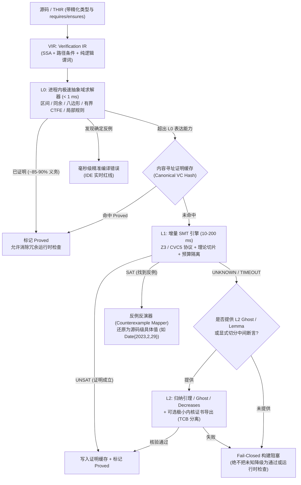

# 03 — 三层分层形式化验证引擎设计（Tiered Built-in Formal Verification）

> 本章解决的核心问题是：**如何在不牺牲日常开发反馈速度（目标毫秒级 IDE 体验）的前提下，把形式化验证从“学术高门槛工具”变成“编译器内置的日常基础设施”，并同时兼容业务精化、复杂算法契约与 AI Vericoding 闭环。**

---

## 1. 为什么传统验证语言和 `loom-lang` 现方案会变重、变慢？

在审视 `loom-lang`、Dafny、Verus、F\*、Ora 与 MoonBit 0.9 之后，我们发现造成形式化验证“重、慢、脆弱”的三大根源：

1. **别名爆炸（Aliasing Explosion）与帧问题（Frame Problem）**：
   - 在共享可变 GC 堆（如 `loom-lang` 现方案）上，每次函数调用、循环回边或闭包捕获都可能通过未知别名破坏已建立的精化不变量。
   - 结果：编译器必须投入数万行代码追踪 `heap version`、`allocation epoch`、`draft publication` 和复杂的排除集，且稍有跨边界共享就被迫保守拒绝。
2. **杀鸡用牛刀（单层全压 SMT）**：
   - 明明 `Odd + Odd -> Even`、`0 <= i < len`、`Date { 2024, 2, 29 }` 这种 85%–90% 的日常约束只需微秒级本地抽象域即可瞬间判定，如果每次都序列化为 SMT-LIB2 喂给外部 Z3 进程，编译与编辑延迟必然飙升到秒级～十秒级。
3. **诊断不可操作（Opaque Solver Failure）**：
   - SMT 返回 `UNKNOWN` 或超时时，开发者和 AI Agent 都不知道到底是“代码真有 Bug”、“缺少循环不变量/前置条件”，还是“求解器陷入非线性算术瓶颈”。

Tenon 的解法是：**以 MVS 无共享可变别名作为语义前提（直接砍掉 80% 帧问题复杂度），再构建 L0 / L1 / L2 三层递进式验证内核。**

---

## 2. 三层验证流水线架构（L0 → L1 → L2）



---

## 3. 各层职责与技术实现细节

### 3.1 L0 — 进程内极速抽象域求解器（< 1 ms，零外部依赖）

L0 直接编译进 Tenon 前端进程内，不启动任何外部求解器，在 `tenon check` 和 LSP 实时键入时始终全速运行。它组合四个高度正交且**多项式时间可判定**的域：

| L0 内置域 | 数学表示 | 秒解的典型约束 | 复杂度 |
| --- | --- | --- | --- |
| **1. 区间域（Interval）** | $l \le x \le u$（含 64 位/精确溢出边界） | `Amount > 0`、`Percentage ∈ [0, 100]`、常量范围传播、加减乘除范围推导 | $O(1)$ / 变量 |
| **2. 同余域（Congruence）** | $x \equiv r \pmod m$ | `Odd` / `Even`、`Odd + Odd -> Even`、`Aligned[4096]`、步长循环索引 | $O(1)$ / 变量 |
| **3. 八边形/差分域（Octagon / DBM）** | $\pm x \pm y \le c$ | `a <= b`、`i < xs.len`、`start <= end`、数组安全索引消除、相邻元素扫描 | $O(k^2)$（按函数内局部关联变量分簇，$k$ 通常 < 20） |
| **4. 有界纯函数局部求值（Bounded CTFE）** | 对已知实参或有限域枚举展开 `pure` 函数 | `Date { 2024, 2, 29 }` 算出 `days_in_month == 29`；正则/格式字面量静态检查；`ensures` 摘要替换 | 固定步数预算（如 1024 步） |

**关键工程红利**：
- 普通项目在编辑代码时，**无需安装或启动 Z3 就能实时验证几乎全部的精化类型（正数、奇偶、日期字面量、数组越界、除零、简单 `requires`）**；
- 与 `Gojo` / `Goose` 的 `checkfree fn` 理念对齐：开发者可以标注 `@checkfree` 要求某个热点函数内所有边界/溢出/精化检查必须被 L0/L1 完全消除，否则编译报错！

### 3.2 L1 — 增量 SMT 自动证明引擎（10–200 ms，严格 Fail-Closed）

当验证条件（VC, Verification Condition）超越 L0（例如非线性乘法关系、跨字段复杂公式、`old(x)` 前后状态对比、跨版本精化蕴涵 $P_{V1} \implies P_{V2}$、残差域 $\Delta = P_{V1} \land \neg P_{V2}$ 计算），进入 L1：

1. **理论切片与逻辑正规化（Theory Slicing & Canonicalization）**：
   - 每个函数的 VC 按目标切分为相互独立的原子证明义务（例如一条 `ensures`、一处 `mutate` 退出检查、一条精化构造）；
   - 仅编码该 VC 可达依赖闭包中的变量与纯函数摘要（**绝不把整个模块的非相关前提塞给 SMT**），避免量词触发器爆炸；
   - 将变量名 alpha-规约化后计算 SHA-256 作为 **Canonical VC Hash**，使单行注释/重命名/无关函数修改 100% 命中证明缓存（支持本地共享缓存与 CI 只读校验）。
2. **多求解器后端与确定性控制**：
   - 默认通过常驻进程（增量 `push`/`pop` 上下文）复用 **Z3** 或 **CVC5**，避免 Loom 频繁拉起子进程的冷启动开销；
   - 采用固定随机种子与基于**逻辑步数上限（`rlimit`）而非墙钟时间**的确定性预算，确保 macOS / Linux / Windows 上不会出现“本地过、CI 随机超时”的玄学构建。
3. **绝对 Fail-Closed 铁律（继承自 `loom-lang` 与 `Ora`）**：
   - `ensures`、`invariant`、`@checkfree` 和跨版本兼容性证明遇到 `UNKNOWN` 或 `RLIMIT_EXCEEDED` **一律拒绝构建**；
   - 严格区分四级证据标签，并在构建回执（Build Receipt）和诊断中公开标注：
     - `proved`：L0/L1/L2 静态数学证明成立；
     - `checked`：无法静态证明，已在边界生成显式运行时检查（如 `Date.parse`）；
     - `tested`：仅通过单元测试/模糊测试采样，不构成全称证明；
     - `assumed`：外部 FFI、部署初始历史状态或显式 `unsafe`/`assume` 边界，必须显式审计追踪。
4. **可解释反例反演器（Counterexample & Unsat-Core Diagnostics）**：
   - 借鉴 `Ora --explain`：当 SMT 返回 `SAT`（找到反例）时，不是吐出晦涩的 S-expression，而是把模型映射回源类型与字段名，直接打印最小反例！
   ```text
   error[V1004]: postcondition `ensures` may be violated
     --> calendar.tn:42:5
      |
   40 | pub pure fn add_one_year(d: Date) -> Date {
   41 |     Date { year: d.year + 1, month: d.month, day: d.day }
      |     ^^^^^^^^^^^^^^^^^^^^^^^^^^^^^^^^^^^^^^^^^^^^^^^^^^^^^
      |
      = counterexample:
          d = Date { year: 2024, month: 2, day: 29 }
      = failed predicate:
          day <= days_in_month(year, month)
          evaluated: 29 <= days_in_month(2025, 2)  -->  29 <= 28 (false)
      = hint: consider clamping Feb 29 to Feb 28 on non-leap years, or return Result[Date, CalendarError]
   ```

### 3.3 L2 — Ghost 规约、归纳引理与极小可信内核（按需启用）

业务代码 95% 停留在 L0+L1 即可，但遇到排序置换、树/图算法、共识状态机、加密原语或循环终止性时，SMT 无法自动凭空猜出归纳假设。此时引入与普通代码语法完全一致的 L2 设施（借鉴 Dafny / Verus / Bend 2）：

- **`ghost` 仅验证期存在，编译时 100% 擦除**（零运行时内存与指令开销）；
- **`invariant` 与 `decreases`**：显式声明循环不变量与良基终止度量；
- **`lemma`**：编写可复用的数学性质辅助证明，供 L1 SMT 作为已证明前提调用；
- **面向高安全场景的独立证书导出（远期）**：对关键内核/金融账务模块，可将 L1/L2 证明步骤导出为极小核验内核（类似 BendTT / Why3 / Lean 4 proof term）复核，实现“编译器实现可能有 Bug，但极小 TCB 证明核验器独立担保正确性”。

```tenon
// L2 示例：排序的完整规约（纯值语义/inout 独占，零别名干扰烦恼！）
pub ghost pure fn is_sorted(xs: Slice[Int64]) -> Bool {
    forall i: USize where i + 1 < xs.len => xs[i] <= xs[i + 1]
}

pub ghost pure fn is_permutation(a: Slice[Int64], b: Slice[Int64]) -> Bool {
    a.len == b.len && (forall v: Int64 => count(a, v) == count(b, v))
}

pub fn insertion_sort(inout xs: List[Int64])
    ensures is_sorted(xs)
    ensures is_permutation(xs, old(xs))
{
    var i: USize = 1
    while i < xs.len
        invariant 1 <= i && i <= xs.len
        invariant is_sorted(xs[0..i])
        invariant is_permutation(xs, old(xs))
        decreases xs.len - i
    {
        // ... 局部交换，因为 inout xs 独占，无需任何全局堆帧条件或别名排除！
        i += 1
    }
}
```

---

## 4. 关键架构对比：为什么 MVS 让验证引擎瘦身 10 倍？

把 `loom-lang` 的共享可变 GC 模型与 Tenon 的默认 MVS 模型放在验证器视角下逐项对比：

| 验证场景 | `loom-lang`（默认共享可变 GC） | `Tenon`（默认 MVS 独占值语义） |
| --- | --- | --- |
| 构造后保持精化不变量 | 需证明无 raw outer alias 逃逸、无 element backreference、无未受控闭包捕获 | **天然自动成立**（逻辑上无共享可变别名） |
| 函数调用后的帧条件（Frame） | 任何未知调用/回调都可能修改任意可达堆对象，必须做复杂逃逸与堆版本分析 | 未以 `inout` 传入的值**数学上必然不变**；仅需更新显式 `inout` 参数的局部状态 |
| 多字段更新（如 `Date`） | 需追踪是否被回调/别名/协程挂起观察到半成品状态 | `mutate d { ... }` 独占锁死词法块，块内禁止把未完成 `d` 交给需要 `Date` 的函数，退出点单点证明即可 |
| 异步 `.await` 跨挂起点 | 挂起期间其他任务可能改写共享堆，几乎所有非私有堆观测被迫失效 | 局部值语义变量挂起期间**完全免疫外部修改**；仅显式共享状态（如 `Store`/`Channel`）需重新观测 |
| 编译器验证核心代码规模 | `loom-lang` 仅前端+验证已膨胀至 **14.6 万行** | 预计核心 L0+L1 验证器可控制在 **1.5–2.5 万行**清晰可维护的 Rust 代码 |

---

## 5. 为 2026+ AI Vericoding 时代原生设计

2026 年的实践（MoonBit 0.9、Anthropic+Theorem Rocq 证明、KVerus）表明：**AI 极其擅长“读报错 → 修代码/补不变量 → 重新验证”的闭环，前提是编译器提供高质量、低延迟、机器可读的验证反馈。**

Tenon 在验证协议层内置对 AI Agent 的一等支持：
1. **`tenon verify --format=json` 结构化验证契约输出**：每条失败义务精确输出：
   - 失败类型（`RefinementViolation` / `PostconditionFailed` / `LoopInvariantNotPreserved` / `SolverBudgetExceeded`）
   - 源码定位与涉及的精化谓词 AST
   - **最小具体反例（Concrete Counterexample）**
   - **不可满足核心（Unsat Core）或缺失的前提候选（Missing Premise Hints）**
2. **极快迭代环路**：L0 毫秒级拦截低级幻觉，L1 增量缓存保证 Agent 改一行代码只需重跑受影响的 1–2 个 VC（<50ms），避免整项目重验。
3. **规格即边界（Spec as Guardrail）**：人类架构师聚焦编写**精化类型（`Date`、`Amount`、`OrderStatus`）、函数 `requires`/`ensures` 与版本 `evolution` 契约**，AI 负责生成实现体与 L2 循环不变量/引理，编译器做铁面无私的数学裁判。
