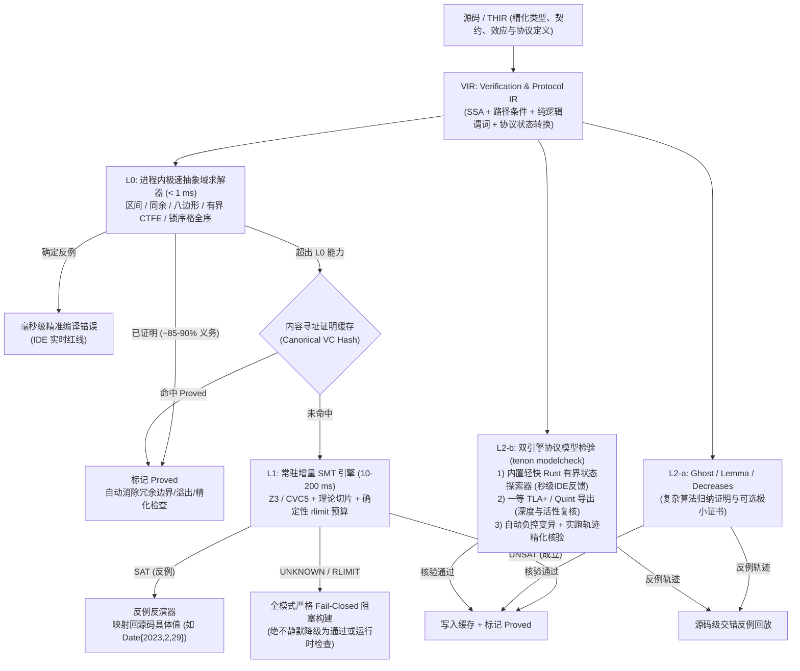

# 03 — 三层分层形式化验证引擎与双引擎协议验证设计

> 本章定义 Tenon 内置的 **L0 / L1 / L2 三层验证内核**（依据 [ADR-0001 (D03, D05, D10)](adr/0001-architecture-decisions.md) 定稿）：既保证日常 85%–90% 精化约束在 <1ms 内无外部依赖完成，又对全部 `ensures` 严格 Fail-Closed，并将**多节点分布式协议模型检验（`tenon modelcheck`）**升级为一等工具链能力。

---

## 1. 为什么传统验证语言和 `loom-lang` 现方案会变重、变慢？

1. **别名爆炸与帧问题**：默认共享可变 GC 堆导致每次调用、循环或挂起都可能被未知别名改坏精化不变量；Tenon 选择默认 **MVS 无共享可变别名**，直接消解约 80% 帧条件复杂度。
2. **单层验证全压外部 Z3**：把 `Odd + Odd -> Even`、`0 <= i < len`、`Date { 2024, 2, 29 }` 也序列化进外部 SMT 进程，会严重拖慢编辑与构建反馈。
3. **单步 SMT 抓不住多节点分布式协议交错缺陷**：SMT 擅长证明单步精化、函数前后置条件与迁移透镜代数，但无法直接替代针对崩溃、网络乱序、迟到回执与新旧版本混跑的**多参与者状态空间探索（Model Checking）**。

---

## 2. 三层验证流水线架构（L0 → L1 → L2）



---

## 3. 各层职责与技术实现细节

### 3.1 L0 — 进程内极速抽象域求解器（< 1 ms，零外部依赖）

直接编译进 Tenon 前端进程，在 LSP 实时键入与 `tenon check` 时全速运行：

| L0 内置域 | 数学表示 | 秒解的典型约束 | 复杂度 |
| --- | --- | --- | --- |
| **1. 区间域（Interval）** | $l \le x \le u$（含固定宽度溢出界） | `Amount > 0`、`Percentage ∈ [0, 100]`、自动消除 `checked` 整数溢出检查 | $O(1)$ / 变量 |
| **2. 同余域（Congruence）** | $x \equiv r \pmod m$ | `Odd`/`Even`、`Odd + Odd -> Even`、`Aligned[4096]` | $O(1)$ / 变量 |
| **3. 八边形/差分域（Octagon）** | $\pm x \pm y \le c$ | `a <= b`、`i < xs.len`、`start <= end`、数组越界消除、锁序格 `Next > Held` | $O(k^2)$（局部变量分簇） |
| **4. 有界纯函数求值（CTFE）** | 对已知实参/有限域展开 `pure` 函数 | `Date { year = 2024, month = 2, day = 29 }` 算出 `29`；字面量正则校验；`ensures` 摘要替换 | 固定步数预算 |

支持热点函数显式标注 `@checkfree`：强制要求函数内全部数组越界、除零与溢出检查被 L0/L1 消除，否则编译报错。

### 3.2 L1 — 常驻增量 SMT 引擎（10–200 ms，全模式严格 Fail-Closed）

负责非线性约束、跨字段不变量、`requires`/`ensures`/`old()`、跨版本精化蕴涵 $P_{V1} \implies P_{V2}$ 与残差域 $\Delta = P_{V1} \land \neg P_{V2}$：

1. **理论切片与 Canonical VC Hash 缓存**：只编码当前证明目标的可达依赖闭包；alpha-规约化后取 SHA-256 缓存，改注释或无关函数 100% 命中。
2. **确定性预算**：基于逻辑步数上限 `rlimit`（而非墙钟超时）保证三平台 CI 构建 100% 确定性；通过常驻增量 `push`/`pop` 会话复用 Z3/CVC5 进程。
3. **严格 Fail-Closed（[ADR-0001 D05](adr/0001-architecture-decisions.md)）**：所有 `ensures`、精化构造、演化兼容性与 `@checkfree` 在全模式（含开发期与 CI）遇到 `UNKNOWN` / `RLIMIT` 一律拒绝构建；严格区分四级证据标签 `proved` / `checked` / `tested` / `assumed`。
4. **源码级可解释反例**：
   ```text
   error[V1004]: postcondition `ensures` may be violated
     --> calendar.tn:41:5
      |
   40 | pub pure fn add_one_year(d Date) Date {
   41 |     Date { year = d.year + 1, month = d.month, day = d.day }
      |     ^^^^^^^^^^^^^^^^^^^^^^^^^^^^^^^^^^^^^^^^^^^^^^^^^^^^^^^^
      |
      = counterexample:
          d = Date { year = 2024, month = 2, day = 29 }
      = failed predicate:
          day <= days_in_month(year, month)
          evaluated: 29 <= days_in_month(2025, 2)  -->  29 <= 28 (false)
   ```

### 3.3 L2-a — Ghost 规约、归纳引理与极小核验内核（按需启用）

```tenon
// L2-a 示例：排序完整规约（MVS + inout 独占，零全局堆帧条件与别名干扰！）
pub ghost pure fn is_sorted(xs Slice[Int64]) Bool {
    forall i USize where i + 1 < xs.len => xs[i] <= xs[i + 1]
}

pub ghost pure fn is_permutation(a Slice[Int64], b Slice[Int64]) Bool {
    a.len == b.len && (forall v Int64 => count(a, v) == count(b, v))
}

pub fn insertion_sort(inout xs List[Int64])
    ensures is_sorted(xs)
    ensures is_permutation(xs, old(xs))
{
    var i USize = 1
    while i < xs.len
        invariant 1 <= i && i <= xs.len
        invariant is_sorted(xs[0..i])
        invariant is_permutation(xs, old(xs))
        decreases xs.len - i
    {
        // 局部交换，独占 inout xs 无需任何别名排除集
        i += 1
    }
}
```

### 3.4 L2-b — 双引擎同源协议模型检验（`tenon modelcheck`，[ADR-0001 D10](adr/0001-architecture-decisions.md)）

专门用于发现分布式协议、调和状态机、并发竞态与滚动升级中的隐蔽设计缺陷：

1. **同一份源码定义协议与故障模型**：标准库协议模板（如 `SyncArchetype`、`AttemptProtocol`、`FencedExecution`、`EvolutionCoexistence`）声明状态迁移、非确定性故障环境（`crash` / `reorder` / `duplicate` / `drop_last_frame` / `partition` / `late_receipt` / `mixed_version_node`）、安全不变量（`invariant`）、时序活性（`eventually` / `leads_to`）与可达性见证（`witness`）。
2. **双引擎协同**：
   - **内置轻快 Rust 有界状态探索器**（默认）：零 JVM 依赖，秒级探索小实例状态空间，一旦违约直接把交错步骤反译回 Tenon 源码行号与变量快照；
   - **一等 TLA+ / Quint 后端导出**（`tenon modelcheck --backend tlc|apalache|quint`）：针对大状态空间、弱/强公平性时序活性与外部独立复核，自动生成固化 `.scope.json` 范围声明并锁定工具 SHA-256。
3. **自动负控变异（Anti-Vacuity Mutation）**：自动对协议围栏注入变异（如去掉 `epoch` 检查、去掉 `conflict_held`、省略 `outbox`），验证模型检验器必须精确命中对应性质反例，防止空洞通过。
4. **实跑轨迹精化核验（Trace Refinement Checking）**：测试夹具可记录真实数据库/网络/并发故障注入运行轨迹，自动回放进协议模型检验其是否为合法状态步进（Stutter-Equivalent Refinement），彻底弥合“模型通过 ≠ 实现正确”的鸿沟。

---

## 4. 为什么 MVS 让验证引擎瘦身 10×？

| 验证场景 | `loom-lang`（共享可变 GC） | `Tenon`（默认 MVS 独占值语义） |
| --- | --- | --- |
| 构造后保持精化不变量 | 需追踪 raw alias 逃逸、element backreference、闭包捕获 | **天然成立**（逻辑上无共享可变别名） |
| 函数调用后帧条件（Frame） | 未知调用可能修改任意可达堆对象，需复杂堆版本失效分析 | 非 `inout` 参数**数学上必然不变**；仅更新显式 `inout` |
| 多字段更新（如 `Date`） | 需防回调/别名/协程观察半成品 | `mutate d { ... }` 独占块 + 无栈协程禁止块内 `.await` |
| 跨 `.await` 挂起 | 挂起期间共享堆可能被他任务改写，几乎全部观测失效 | 局部值变量挂起期间**完全免疫外部修改** |
| 验证器规模预期 | `loom-lang` 前端+验证已达 14.6 万行 | L0 + L1 核心预计控制在 1.5–2.5 万行清晰 Rust 代码 |

---

## 5. 原生支持 AI Vericoding 闭环

- `tenon verify --format=json` 与 `tenon modelcheck --format=json` 输出机器可读的结构化诊断：失败类别、涉及谓词 AST、最小具体反例、缺失前提提示或交错轨迹步骤；
- L0 毫秒级拦下低级幻觉，L1 增量缓存使 AI 局部修补重验耗时 <50ms，L2-b 校验协议交错；人类聚焦写精化类型、契约与协议公理，AI 负责生成实现体与引理，编译器做铁面数学裁判。
