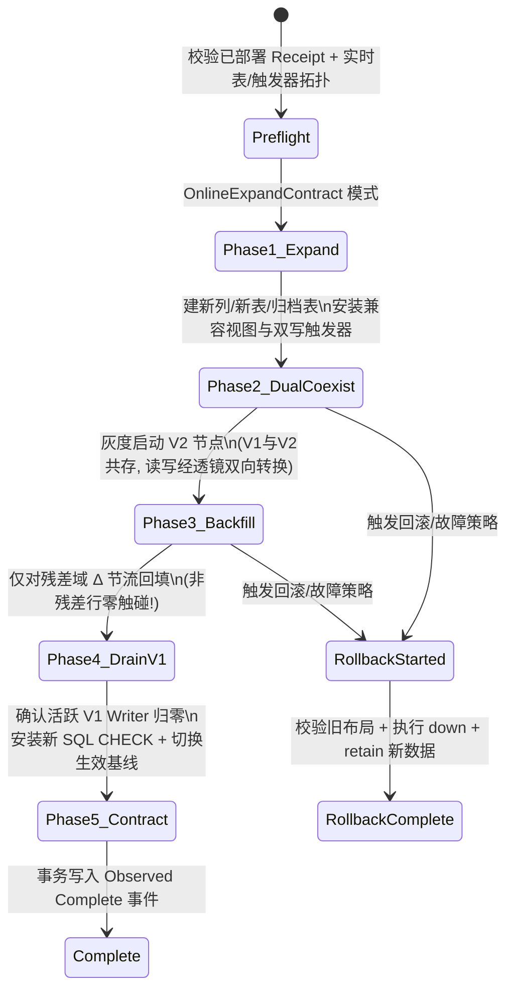

# 04 — 系统级版本演化与兼容性推导引擎（System-Level Evolution Calculus）

> **本章是 Tenon 区别于全球所有现有编程语言（包括 MoonBit 0.9、Ora、Bend 2、Verus、Unison、Blood 等）的核心架构壁垒。**  
> 现代软件工程最大的事故来源往往不是“单版本内部写错算法”，而是**“系统版本演进时，新旧代码、新旧协议、持久化旧数据、灰度双写与紧急回滚之间的隐性不兼容”**。Tenon 把这一整套问题提升为语言级的一等演算。

---

## 1. 为什么传统版本管理与迁移方案会失效？

| 传统做法 | 致命盲区 |
| --- | --- |
| **SemVer 版本号**（`1.2.0` → `1.3.0`） | 纯属人类主观标签。把 `amount >= 0` 改成 `amount > 0` 贴个 minor 标签，包管理器毫无察觉，上线直接炸库。 |
| **Protobuf / Avro 字段级检查** | 只能检查“字段号是否复用、基础类型是否变了”，**完全看不懂精化约束与跨字段不变量**（如金额收紧、日期闰年规则修正、状态机新增变体）。 |
| **手写 SQL 迁移脚本**（Flyway / Goose / Prisma） | 1）与业务代码类型割裂，无人证明脚本跑完后一定满足新代码不变量；2）往往只写 `UP` 不验证 `DOWN`；3）遇到**升级 → 降级回 v1 → v1 继续写新数据 → 再次升级回 v2** 时极易丢数据或撞主键。 |
| **Unison 式纯内容寻址数据库** | 解决了内存函数重命名，但强迫放弃普通文本文件与 Git，且未解决外部关系数据库持久化表的双向演化与回滚保留。 |
| **`loom-lang` 现有 N3 原型** | 已经指明了极其正确的方向（部署基准、账本、降级保留数据、区分观测与假设），但目前拆散为手工 `.loom-ids` + 单字段 `field_implies` + 写死 `orders`/`notes` 的离线 SQLite 脚本，尚未抽象成通用语言机制。 |

---

## 2. 双轨语义身份模型（Ordinary Source + Evolution Lock）

Tenon 坚持 **“源码永远是普通文本文件，兼容任何编辑器、Git 和 AI 工具”**，同时通过双轨机制消除手工维护 `.loom-ids` 的痛苦：

1. **显式演化边界注解（仅标注需要跨版本/跨进程/持久化稳定的边界）**：
   - 普通内部辅助函数无需写任何 ID；
   - 需要跨版本演化的**持久化实体、Wire/RPC 协议消息、对外稳定契约**使用显式稳定标识与字段槽位号：
     ```tenon
     @evolve("billing.Order", version = 2, storage = "orders")
     pub struct Order {
         @field(1) id: Int64,
         @field(2) amount: Int64 where self > 0,
         @field(3) billing_date: Date,
         @field(4) note: Option[Text] = None,
     }
     ```
   - 重命名字段名（如把 `amount` 改名为 `total_cents`，但保持 `@field(2)`）被编译器自动识别为**元数据重命名而非删列新建**。
2. **编译器自动维护的 `tenon.evolution.lock` 与构建回执（Build Receipt）**：
   - 每次发布构建（`tenon build --release --receipt prod-v2.receipt`），编译器自动将所有可达 `@evolve` 类型、规范化精化谓词（PNF）、公共函数契约（`requires`/`ensures`/效应）、依赖图锁定哈希与证明证据摘要写入不可变的 **Deployment Basis Receipt**。
   - 对比兼容性时，**永远对比实际已部署的基线 Receipt 与当前候选产物**，绝不轻信 Git Commit 或 SemVer 标签。

---

## 3. 四维 SMT 兼容性自动推导引擎

执行 `tenon evolve check --from prod-v1.receipt --to target/v2.receipt` 时，编译器利用第 03 章的 L0+L1 求解器，在**四个系统维度**上自动推导出数学级兼容性矩阵：

### 3.1 持久化存储与精化类型维度（Storage & Data Invariant Compatibility）

设同一实体在旧版 $V_1$ 与新版 $V_2$ 的类型域与精化谓词分别为 $(T_1, P_1)$ 与 $(T_2, P_2)$。编译器自动求解两个蕴涵式：
- **升级安全（旧数据是否天然合法为新类型）**：$\text{UpgradeSafe} \iff \forall x.\; P_1(x) \implies P_2(x)$
- **降级/回滚安全（新数据是否天然合法为旧类型）**：$\text{DowngradeSafe} \iff \forall x.\; P_2(x) \implies P_1(x)$

由此自动归类为 4 种精确结论，并在不成立时**自动给出 SMT 反例与精确残差域（Residual Domain）**：

| 推导结果 | 逻辑条件 | 系统级工程含义 | 编译器动作 |
| --- | --- | --- | --- |
| **1. 等价兼容（Equivalent / Hotfix-Safe）** | $P_1 \iff P_2$ 且物理映射等价（例：`x > 0 && x % 2 == 1` 重构为 `x >= 1 && x % 2 != 0`，或仅修改纯内部实现且所有对外契约兼容） | **零迁移、零停机热更新安全** | 自动签发 `HotfixCompatible` 证明凭证 |
| **2. 纯放宽（Widening / Backward-Safe）** | $P_1 \implies P_2$，但 $P_2 \not\implies P_1$（例：`amount > 0` 放宽为 `amount >= 0`，或新增带默认值的可选字段） | **升级无需洗数**；但若存在在线回滚或 V1/V2 灰度共存，旧节点读到新值（如 `amount == 0`）会失败！ | 升级放行；若策略要求 `rolling` 或 `rollback`，强制提供 `down` 逆向适配与残差处理 |
| **3. 纯收紧（Narrowing / Breaking Upgrade）** | $P_2 \implies P_1$，但 $P_1 \not\implies P_2$（例：`amount >= 0` 收紧为 `amount > 0`；或 `Date` 修复之前漏判的闰年校验） | 历史库中**可能存在**满足残差域 $\Delta = P_1 \land \neg P_2$ 的记录（即便今天线上抽查为 0 条，也绝不跳过协议！） | **阻塞发布**，输出反例与精确残差域 $\Delta$，强制要求提供已证明覆盖 $\Delta$ 的 `evolution` 透镜 |
| **4. 交叉/重构（Divergent）** | 互不蕴涵，或字段拆分/合并（例：`full_name: Text` 拆分为 `first_name` + `last_name`） | 升级与降级均需显式数据变换 | **阻塞发布**，强制提供双向 `evolution` 透镜 |

### 3.2 线协议与 RPC 维度（Wire / Rolling Coexistence Compatibility）

对于分布式服务间消息（标注 `@evolve(..., wire = "rpc")`），编译器自动区分**生产者（Writer）**与**消费者（Reader）**方向：
- **Backward Compatible**：$V_2$ 消费者能安全解码 $V_1$ 生产者发出的任何合法消息；
- **Forward Compatible**：$V_1$ 消费者能安全解码 $V_2$ 生产者发出的任何合法消息（包含忽略未知可选字段时的语义完整性，以及枚举扩展需显式 `@open` 兜底分支）；
- **Rolling-Safe（全兼容）**：同时满足 Backward 与 Forward；如果只有单向兼容，编译器直接推导出**合法的发布顺序约束**（例如：“必须先全部升级 Consumer 到 V2，再升级 Producer 到 V2”）。

### 3.3 库与公共 API 契约维度（Liskov 行为子类型推导）

当升级一个共享库模块时，编译器不再只看函数名和基础类型，而是执行**行为子类型（Behavioral Subtyping）证明**：
对于公开函数 `f`（$V_1 \to V_2$）：
1. **参数类型与前置条件逆变（Contravariant）**：$R_{V1} \implies R_{V2}$（新版只能接受更广或相等的输入，不能悄悄加严前置条件）；
2. **返回类型与后置条件协变（Covariant）**：$E_{V2} \implies E_{V1}$（新版承诺的结果必须至少和旧版一样强）；
3. **效应子集**：$\text{Eff}_{V2} \subseteq \text{Eff}_{V1}$（原本 `pure` 的函数不能悄悄变成带 `io` 副作用的函数）；
4. **过载与分派不变性**：对比所有可达调用点的绑定目标，禁止新增重载悄悄劫持旧调用。

任何违反上述 4 条的变更，编译器**自动判定为 Breaking API Change 并指明具体破坏的契约与反例**——彻底终结“靠感觉定 SemVer 版本号”的时代。

### 3.4 真实场景演练：如果历史版本 `Date` 有闰年 Bug 怎么办？

假设 `v1` 的 `Date` 忘记校验 100 年不闰（误写了 `y % 4 == 0`），`v2` 修复为 `(y % 4 == 0 && y % 100 != 0) || y % 400 == 0`：
- 运行 `tenon evolve check --from v1.receipt --to v2.receipt`：
  ```text
  [BREAKING] entity `calendar.Date` (storage: `events.event_date`):
    Predicate narrowed: P_v1 ⇏ P_v2
    Counterexample found by L1 (Z3, 18ms):
      year = 1900, month = 2, day = 29
    Residual Domain Δ = { d : Date@v1 | d.year % 100 == 0 && d.year % 400 != 0 && d.month == 2 && d.day == 29 }
    Action required: declare `evolution Date: v1 <-> v2` covering Δ before release.
  ```
这就是“精化类型 + SMT + 版本演化”联动产生的降维打击体验：**连百年闰年修复这种极度隐蔽的历史脏数据隐患，编译器都能在发布前 18 毫秒内精准算出反例 `1900-02-29` 和精确残差集合！**

---

## 4. 一等双向演化透镜（Verified Bidirectional Evolution Lenses）

受 **Project Cambria** 双向透镜理论与 `loom-lang` 降级保留需求启发，Tenon 把版本迁移抽象为语言内的一等声明 `evolution`，由编译器静态验证其四大数学定律：

```tenon
evolution Order: v1 <-> v2
    policy {
        failure: Rollback,              // 明确失败策略：Stop | Rollback（禁止运行时猜测）
        mode: OnlineExpandContract,     // 自动验证在线双写与共存条件
    }
{
    // 1. 残差归档表（记录因收紧约束被替换的原始数据，保证回滚保真）
    archive ZeroAmounts {
        order_id: Int64,
        old_amount: Int64 where self == 0,
    }

    // 2. 升级透镜：把任意合法 v1 映射到合法 v2 + 可选归档
    up(old: Order@v1) -> (Order@v2, Option[ZeroAmounts]) {
        if old.amount == 0 {
            (Order@v2 { id: old.id, amount: 1, note: None },
             Some(ZeroAmounts { order_id: old.id, old_amount: 0 }))
        } else {
            (Order@v2 { id: old.id, amount: old.amount, note: None }, None)
        }
    }

    // 3. 降级透镜：把 v2 + 归档还原为 v1，并显式声明保留新列 note
    down(new: Order@v2, arch: Option[ZeroAmounts]) -> Order@v1
        retain(new.note)                // 降级回 v1 时物理保留 note 列/表，不删数据！
    {
        match arch {
            Some(a) if new.amount == 1 => Order@v1 { id: new.id, amount: a.old_amount },
            _ => Order@v1 { id: new.id, amount: new.amount },
        }
    }

    // 4. 降级后再升级（Retained Re-Upgrade）：合并 v1 期间的新改写与保留的 note
    reup(current: Order@v1, retained_note: Option[Text], prev_arch: Option[ZeroAmounts])
        -> (Order@v2, Option[ZeroAmounts])
    {
        if current.amount == 0 {
            // 无论原本就是 0 还是降级期间 v1 新改/新插的 0，统一安全处理并保住 retained_note
            (Order@v2 { id: current.id, amount: 1, note: retained_note },
             Some(ZeroAmounts { order_id: current.id, old_amount: 0 }))
        } else {
            // 如果降级期间 v1 把订单改成了正数，保留 v1 的新正数并丢弃过期归档，同时保住 retained_note！
            (Order@v2 { id: current.id, amount: current.amount, note: retained_note }, None)
        }
    }
}
```

### 编译器强制证明的 4 条演化铁律

| 定律 | 数学表达 | 解决的真实线上灾难 |
| --- | --- | --- |
| **1. 全覆盖与目标合法性（Totality & Target Validity）** | $\forall x \in V_1.\; \text{up}(x) \text{ 终止且返回合法 } (y \in V_2, a)$ | 杜绝迁移脚本跑到第 500 万行因边缘数据崩溃或产出违背新不变量的脏行 |
| **2. 回滚无损律（Round-Trip / PutGet）** | $\forall x \in V_1.\; \text{let } (y, a) = \text{up}(x);\; \text{down}(y, a) == x$（除非显式标注 `@allow_loss(field)`） | 杜绝“升级一时爽，回滚火葬场”；任何不可逆丢弃必须代码评审显式签字 |
| **3. 降级保数据与再升级律（Retained Re-Upgrade）** | 证明 `reup` 在 `v1 → v2 → down(v1) → v1 写入 → reup(v2)` 后仍满足 $V_2$ 全部不变量且不覆盖 v1 合法写入、不丢失 `retain` 字段 | 完美泛化 `loom-lang` 最宝贵的部署场景，从手工写死 SQLite 升级为任意实体通用的编译期定理 |
| **4. 跳过中间版本组合律（Composition）** | 对跳级迁移 `v1 -> v3` 或多步组合 `up_{23} ∘ up_{12}` 自动验证组合后仍满足目标不变量（且不假装恢复已显式 `allow_loss` 的历史字段） | 支持生产环境安全跨版本直升与灰度集群多版本混合升级 |

---

## 5. 从编译期透镜到生产部署：在线 Expand-Contract 与部署账本

光有离线类型证明还不够——正如 `loom-lang` RFC 中指出的经典洞见：**“一份被证明的迁移计划，不等于一次已完成的安全部署；旧写入者尚未下线时，回填完成也不算真正完成。”**

Tenon 在标准部署库 `std.evolve` 中把演化透镜直接衔接至**生产执行状态机**：

### 5.1 自动推导发布策略（Deployment Plan Synthesis）



- **精准残差回填优化**：传统迁移往往全表扫描改写；由于 SMT 已经算出了精确残差域 $\Delta$（如 `WHERE amount = 0`），生成的 SQL 回填语句**只触碰残差子集**，大幅降低锁表时间与 I/O 压力！
- **自动生成兼容保护**：在 `Phase2_DualCoexist` 到 `Phase4_DrainV1` 之间，确保旧 V1 Writer 写出的 `amount = 0` 被自动拦截或同步进入归档，直到所有 V1 Writer 实例确认下线（Drain），才允许在 `Phase5_Contract` 收紧数据库 `CHECK (amount > 0)` 约束。

### 5.2 Append-Only 部署账本与未知结果保护（继承并增强 `loom-lang`）

部署状态存储于只追加账本（Append-Only Ledger），严格区分 8 种状态，绝不混淆**观测到的事实（Observed）**与**人工导入的历史假设（Assumed）**：
- `NotDeployed` / `Cancelled`（未启动计划可显式取消或替换）
- `ExpandStarted` / `BackfillInProgress` / `ContractStarted`（带幂等 Action ID 与计划摘要哈希；**网络超时导致回执丢失时，状态进入 `UnknownOutcome`，严禁盲目重试或自动回滚，必须先执行权威只读探针确认事务是否已提交**）
- `Failed(partial_progress)`（依据预先确定的 `Stop` 或 `Rollback` 策略执行，禁止事后猜策略）
- `Complete(observed_receipt)`
- `RollbackStarted` / `RollbackComplete(retained_lineage)` / `RollbackFailed`

---

## 6. 诚实的边界：演化引擎不能承诺什么？

1. **不能自动绕过非托管的外部裸 SQL 篡改**：如果 DBA 或第三方非 Tenon 服务直接执行裸 SQL 破坏了表结构、触发器或 UTF-8 编码，边界解码器会在读取时安全拒绝，预检会报告 `LayoutMismatch` / `DataOrLineageMismatch`，而不会伪造兼容证明。
2. **业务语义等价不等同于类型谓词等价**：把“价格单位从元改成美分”（类型都是 `Int64 where self > 0`）若不通过 `distinct type CnyYuan` / `UsdCents` 或显式语义版本区隔，SMT 无法读心发现单位语义改变。因此 Tenon 鼓励**用强名义精化类型建模所有业务量纲**，让这类变更显式暴露在类型签名中。
3. **跨分布式节点的物理时钟/网络分区仍属运维契约**：编译器可以静态验证协议与状态机兼容，以及强制在 `Contract` 阶段检查旧 Writer 租约已过期，但底层集群的租约隔离（Fencing Token）依赖运行环境正确执行。

> **延伸阅读**：关于如何把本章的静态精化兼容推导与 `dast-os-kernel` 的**少版本化按职责能力子集模型（`required(record, op) ⊆ supported(consumer, op)`）**以及通用分布式同步协议的自演化结合，详见 [06 — 调和状态机形式化、分布式同步协议推导与通用微内核演化](06-reconciliation-and-distributed-sync-calculus.md#5-通用协议与模块的双层自演化融合-dast-os-kerneldocs10-的少版本化能力模型)。
