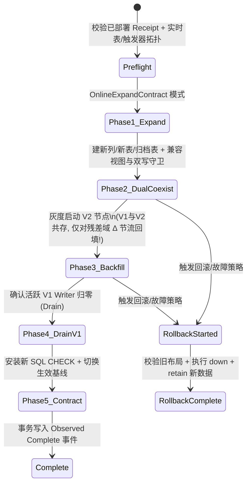

# 04 — 系统级版本演化与兼容性推导引擎（System-Level Evolution Calculus）

> 本章定义 Tenon 的双层系统级演化体系（依据 [ADR-0001 (D06 & D12)](adr/0001-architecture-decisions.md) 定稿，采用 `loom/Go` 简洁语法）：将**静态精化类型兼容与已证明双向透镜**，与源自 `dast-os-kernel` 的**少版本化按职责能力子集模型**统一为语言与工具链的一等演算。

---

## 1. 为什么传统版本管理与迁移方案会失效？

| 传统做法 | 致命盲区 |
| --- | --- |
| **SemVer 版本号**（`1.2.0` → `1.3.0`） | 纯属人类主观标签。把 `amount >= 0` 收紧为 `amount > 0` 贴个 minor 标签，工具链毫无察觉，上线直接炸库。 |
| **Protobuf / Avro 字段级检查** | 只看字段号与基础类型，完全看不懂精化谓词与跨字段不变量（金额收紧、日期闰年规则修正、状态机变体约束）。 |
| **手写 SQL 迁移脚本** | 与业务类型割裂；无人证明跑完满足新不变量；鲜有经验证的 `DOWN` 与“降级保留数据 + v1 继续写入 + 再升级汇聚”保证。 |
| **Unison 式纯内容寻址数据库** | 强迫放弃普通文本文件与 Git 生态，且不解决外部关系数据库持久化表的双向演化。 |
| **`loom-lang` 现有 N3 原型** | 指明了正确方向，但割裂为手工 `.loom-ids` sidecar + 单字段 `field_implies` + 写死 `orders`/`notes` 离线脚本。 |

---

## 2. 双轨语义身份模型（Ordinary Source + Explicit Boundary IDs + Evolution Lock）

依据 [ADR-0001 D06](adr/0001-architecture-decisions.md)：
1. **普通内部代码零注解**：保持普通文本文件与标准 Git 工作流，不为内部函数维护手工 `.loom-ids`；
2. **跨版本持久化/Wire/公开契约显式稳定身份**：
   ```tenon
   @evolve("billing.Order", version = 2, storage = "orders")
   pub record Order {
       @field(1) id           Int64
       @field(2) amount       Int64 where self > 0
       @field(3) billing_date Date
       @field(4) note         Option[Text] = None
   }
   ```
   字段改名但保留 `@field(2)` 自动识别为元数据重命名，而非删列新建。
3. **自动维护 `tenon.evolution.lock` 与不可变构建回执（Build Receipt）**：
   - 发布构建（`tenon build --release --receipt prod-v2.receipt`）自动锁定所有可达 `@evolve` 类型、规范化精化谓词（PNF）、公开函数契约、能力集合与依赖哈希；
   - 兼容性推导**永远对比实际已部署的基线 Receipt 与候选产物**，绝不轻信版本号或 Git Commit 标签。

---

## 3. 四维 SMT 兼容性自动推导矩阵

执行 `tenon evolve check --from prod-v1.receipt --to target/v2.receipt` 时，编译器利用 L0+L1 求解器自动推导：

### 3.1 持久化存储与精化类型维度

对同一实体的旧版 $(T_1, P_1)$ 与新版 $(T_2, P_2)$ 自动判定两个蕴涵式：
- **升级安全**：$\text{UpgradeSafe} \iff \forall x.\; P_1(x) \implies P_2(x)$
- **降级/回滚安全**：$\text{DowngradeSafe} \iff \forall x.\; P_2(x) \implies P_1(x)$

| 推导结果 | 逻辑条件 | 工程含义与编译器动作 |
| --- | --- | --- |
| **1. 等价兼容（Hotfix-Safe）** | $P_1 \iff P_2$ 且物理映射等价 | 零迁移、零停机热更新安全；自动签发 `HotfixCompatible` 证明凭证 |
| **2. 纯放宽（Widening / Backward-Safe）** | $P_1 \implies P_2$，但 $P_2 \not\implies P_1$（例：`> 0` 放宽为 `>= 0` 或新增带默认值可选字段） | 升级无需洗数；若要求滚动共存或回滚，给出旧读新反例并要求降级保留/逆向适配 |
| **3. 纯收紧（Narrowing / Breaking）** | $P_2 \implies P_1$，但 $P_1 \not\implies P_2$（例：`>= 0` 收紧为 `> 0` 或修复闰年规则） | 历史库可能存在残差域 $\Delta = P_1 \land \neg P_2$；**阻塞发布**，输出反例与精确 $\Delta$，强制提供覆盖 $\Delta$ 的已证明 `evolution` 透镜 |
| **4. 交叉/重构（Divergent）** | 互不蕴涵或字段拆合 | 阻塞发布，强制提供完整双向 `evolution` 透镜 |

### 3.2 真实场景演练：修复历史 `Date` 百年闰年 Bug

若 `v1` 误写了 `y % 4 == 0`，`v2` 修复为 `(y % 4 == 0 && y % 100 != 0) || y % 400 == 0`：
```text
[BREAKING] entity `calendar.Date` (storage: `events.event_date`):
  Predicate narrowed: P_v1 ⇏ P_v2
  Counterexample found by L1 (Z3, 18ms):
    year = 1900, month = 2, day = 29
  Residual Domain Δ = { d : Date@v1 | d.year % 100 == 0 && d.year % 400 != 0 && d.month == 2 && d.day == 29 }
  Action required: declare `evolution Date: v1 <-> v2` covering Δ before release.
```

### 3.3 线协议（Wire/RPC）与 API 行为子类型（Liskov）

- **Wire/RPC**：分别推导 Backward / Forward / Rolling-Safe；单向兼容时自动输出集群滚动发布先后顺序约束（例如“先全量升 Consumer，再升 Producer”）。
- **API 行为子类型**：公开函数升级强制验证参数/前置条件逆变（$R_{V1} \implies R_{V2}$）、返回/后置条件协变（$E_{V2} \implies E_{V1}$）、效应子集（$\text{Eff}_{V2} \subseteq \text{Eff}_{V1}$）以及重载绑定不变。

### 3.4 与少版本化能力子集模型的融合（吸收 `dast-os-kernel/docs/10`）

普通功能发布**不推进业务对象全局版本号**。编译器自动按职责（`read` / `execute` / `settle` / `write`）推导每条持久工作/协议信封实际所需的非默认能力集合 `required(record, op)` 与消费节点支持的 `supported(consumer, op)`（累计核心自动压缩为 `implementedThrough >= requiredLevel`，正交扩展自动编码为不可复用 bit 槽位），并自动在 **Claim（路由筛选）** 与 **Commit（权威锁内当前策略复验）** 两处注入门禁，详见 [06 §5](06-reconciliation-and-distributed-sync-calculus.md#5-通用协议与模块的双层自演化融合-dast-os-kerneldocs10-的少版本化能力模型)。

---

## 4. 一等双向演化透镜（Verified Bidirectional Evolution Lenses）

```tenon
evolution Order: v1 <-> v2
    policy {
        failure = Rollback              // 显式预先确定：Stop | Rollback，禁止故障后猜测
        mode    = OnlineExpandContract  // 自动验证在线双写与共存条件
    }
{
    archive ZeroAmounts {
        order_id   Int64
        old_amount Int64 where self == 0
    }

    up(old Order@v1) (Order@v2, Option[ZeroAmounts]) {
        if old.amount == 0 {
            (Order@v2 { id = old.id, amount = 1, note = None },
             Some(ZeroAmounts { order_id = old.id, old_amount = 0 }))
        } else {
            (Order@v2 { id = old.id, amount = old.amount, note = None }, None)
        }
    }

    down(new Order@v2, arch Option[ZeroAmounts]) Order@v1
        retain(new.note)                // 降级回 v1 时物理保留 note 列/表，不删数据！
    {
        match arch {
            Some(a) if new.amount == 1 => Order@v1 { id = new.id, amount = a.old_amount }
            _ => Order@v1 { id = new.id, amount = new.amount }
        }
    }

    reup(current Order@v1, retained_note Option[Text], prev_arch Option[ZeroAmounts])
        (Order@v2, Option[ZeroAmounts])
    {
        if current.amount == 0 {
            (Order@v2 { id = current.id, amount = 1, note = retained_note },
             Some(ZeroAmounts { order_id = current.id, old_amount = 0 }))
        } else {
            (Order@v2 { id = current.id, amount = current.amount, note = retained_note }, None)
        }
    }
}
```

### 编译器强制证明的 4 条演化铁律

1. **全覆盖与目标合法性（Totality & Target Validity）**：$\forall x \in V_1.\; \text{up}(x)$ 终止且产出合法 $V_2$；
2. **回滚无损律（Round-Trip / PutGet）**：$\forall x \in V_1.\; \text{down}(\text{up}(x)) == x$（除非显式标注 `@allow_loss(field)`）；
3. **降级保留与再升级律（Retained Re-Upgrade）**：`v1 → v2 → down(v1) → v1 新写入 → reup(v2)` 保持 $V_2$ 全部不变量，既保留 `v1` 合法改写又不丢 `retain` 字段；
4. **跳过中间版本组合律（Composition）**：验证跨版本直升仍满足目标不变量，且绝不假装恢复已显式 `allow_loss` 的历史字段。

---

## 5. 在线 Expand-Contract 部署计划与 Append-Only 账本



- **精准残差回填**：利用 SMT 算出的残差域 $\Delta$（如 `WHERE amount = 0`）仅触碰受影响行；
- **Append-Only 账本**：严格区分 `NotDeployed` / `Cancelled` / `ExpandStarted` / `BackfillInProgress` / `UnknownOutcome`（严禁盲目重试或自动回滚，须先权威只读探针核实）/ `Failed` / `Complete(observed)` / `RollbackComplete(retained_lineage)`，绝不混淆 `Observed` 与人工导入的 `Assumed`。

---

## 6. 诚实的边界

1. **外部裸 SQL 篡改**：非托管裸 SQL 破坏表结构或编码时，边界解码安全拒绝、预检报 `LayoutMismatch` / `DataOrLineageMismatch`，绝不伪造兼容证明。
2. **业务量纲语义**：如将价格从“元”改为“美分”，须使用 `distinct type CnyYuan` / `UsdCents` 显式区分，让语义变更暴露于类型签名。
3. **集群租约隔离**：编译器验证协议与状态机兼容并强制 `Contract` 前校验旧 Writer 排空证明，底层物理 Fencing Token 依赖运行环境正确执行。
