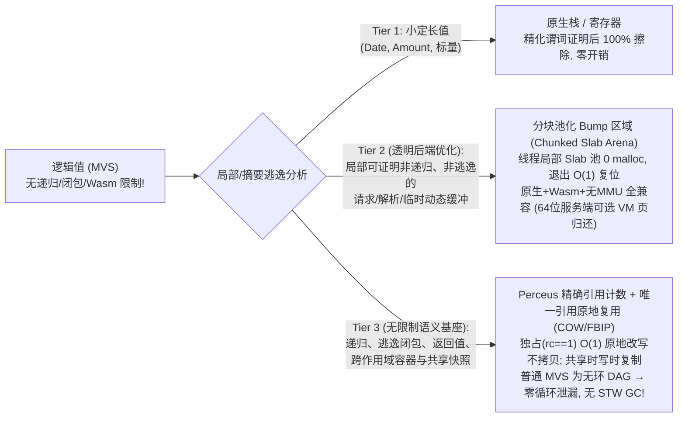
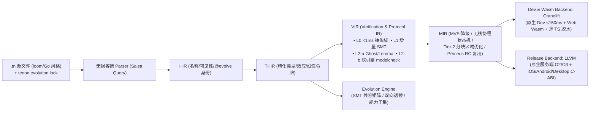

# 05 — 内存模型、无栈并发、多端编译与编译器实现路线

> 本章严格依据 [ADR-0001 (D03, D04, D08, D09, D11, D13)](adr/0001-architecture-decisions.md) 定稿，融合 [`lang-research`](../../lang-research) 对 Perceus、Goose 数据栈与区域回收的实测结论，以及对 Goose 硬限制的彻底规避方案。  
> **效率标杆**：开发期编译速度对标 **Go / Zig**，发布期执行性能对标 **Rust / C**，同时无缝支撑 **原生服务端 + Wasm 前端 + 移动端/桌面 C-ABI + 无 MMU 嵌入式**。

---

## 1. 内存模型：MVS + Perceus 无限制基座 + 透明 Tier-2 区域优化

### 1.1 语言层语义：默认可变值语义（MVS）+ 局部 `inout`（零 `'a` 标注）

1. **所有普通值（标量、`record`、`enum`、`Text`、`List`、`Map`）均为逻辑值语义**：
   - `let b = a` 逻辑独立，修改 `b` 永不影响 `a`；**零共享可变别名**，不仅杜绝隐蔽篡改，还直接让形式化验证复杂度下降 ~10×。
2. **原地修改通过调用点 `inout` 表达（零 Rust `'a` 生命周期注解）**：
   - 普通参数默认只读借用；原地修改声明 `fn push[T](inout xs List[T], item T)`；
   - 静态局部排他性检查（Law of Exclusivity）禁止把重叠可变路径同时传给两个 `inout` 参数；借用不存入普通 `record`，彻底免除生命周期参数传播。
3. **自动最后使用转移（Last-Use Move）**：编译器自动检测值在传参/赋值后不再读取，直接零拷贝转移所有权，无需满屏手写 `.clone()`。

### 1.2 应对 Goose 限制的核心架构决策（[ADR-0001 D09](adr/0001-architecture-decisions.md)）

[`lang-research`](../../lang-research/languages/goose.zh-CN.md) 明确暴露了 Goose 内存模型的 6 大硬限制：**递归不能保留可增长局部数据、无逃逸闭包/函数指针、强依赖大块虚拟地址预留（无法跑在 Wasm 32 位线性内存或无 MMU 嵌入式上）、长容器无法独立回收中间空洞、池复用存在 ABA 身份漏洞、全程序栈编号分配影响增量编译速度**。

因此 Tenon **绝不把 Goose 数据栈作为语言层硬语义限制**，而是彻底反转主次关系：

- **绝不因优化失败而拒绝用户程序**：当某个缓冲区在递归中增长或被逃逸闭包捕获时，编译器自动、语义透明地交由 **Tier 3（Perceus RC + 原地复用）** 处理，普通业务代码享受 100% 语言自由度；
- **热点确定性硬契约（`@no_heap_alloc` / `@fip`）**：对性能关键路径（编解码、协议解析、交易撮合、帧合并器），开发者可显式标注 `@no_heap_alloc` 或 `@fip`（Fully In-Place）——编译器强制证明所有分配均落在 Tier 1/Tier 2 或 Perceus 确定性原地复用，**违反即硬编译报错（绝不像 Koka 那样仅报警告）**；
- **长期可变循环图显式边界 `Store[T]`**：需要表达 DOM/AST 编辑器、ECS 或长寿命带环对象图时，使用 `Store[T]` + **不可回绕代次句柄 `Handle[StoreTag, T]`**（耗尽代次即冻结槽位，彻底修复 Goose 池的 ABA 身份漏洞）+ **短访问阶段 `phase(store)`**（延迟提交删除/压缩，静态禁止视图逃逸或在 `phase` 内 `.await` 挂起）。

### 1.3 资源清理与内存回收正交解耦

文件句柄、网络连接、数据库事务、线性协议令牌（`AdmittedAttempt`）标注为 `linear` / `MustUse`，由词法 `scoped` / `defer` 在正常返回、错误传播（`?`）与任务取消路径上严格 LIFO 确定性清理。

---

## 2. 显式效应系统与无栈结构化并发（[ADR-0001 D04](adr/0001-architecture-decisions.md)）

### 2.1 轻量显式效应与效应多态

| 效应 | 含义 | 编译与验证意义 |
| --- | --- | --- |
| `pure` | 无外部 I/O、无非确定性、无全局可变态（允许局部 `var`） | 可在精化谓词、CTFE、L0/L1/L2 证明中安全调用 |
| `io[Cap]` | 显式声明外部能力（`Fs` / `Net` / `Clock` / `Db` / `Env`） | 防止三方库或 AI 代码偷跑隐蔽 I/O；支持确定性受控时钟/故障注入测试 |
| `async` | 可能挂起等待异步完成 | 精确追踪挂起点，**静态禁止在 `mutate`、持锁、`phase(store)` 内 `.await`** |
| `unsafe` | C FFI / 裸指针等不安全边界 | 独立隔离并记入 Build Receipt 审计清单，禁止污染 `proved` 证明闭包 |

通过**效应多态（Effect Polymorphism）**，高阶集合函数（如 `list.map` / `list.filter`）自动透传回调的效应，大幅缓解传统 `async` 函数染色痛点。

### 2.2 统一无栈协程（Stackless MIR State Machine）

- **全平台一套机制**：在 MIR 层把 `async fn` 降级为紧凑类型化状态机，**零虚拟内存页预留依赖**——原生高并发 Gateway/Worker、浏览器 Wasm 前端协调器、iOS/Android 嵌入库与无 MMU 嵌入式共用完全一致的异步语义；
- **天然无数据竞争**：默认 MVS 不可变快照跨任务只读共享零深拷贝；封闭数据所有权通过 `move` 跨任务零拷贝移交；结构化 `task.scope` 强制子任务在作用域退出前完成或取消并排空清理。

---

## 3. 编译期计算与只读反射

- **`comptime` 纯求值**：任何 `pure` 函数可在编译期执行（驱动 `Date` 字面量验证、正则 DFA 编译、协议约束求解）；
- **只读 Schema 反射**：严格遵守 `pub` 可见性，允许纯源码编写零反射 JSON/Binary/SQL Codec、SQL `CHECK` 翻译器、属性测试生成器与协议适配描述符；
- **受控构建输入**：所有编译期文件读取自动绑定为 tracked inputs，进入增量缓存与 Build Receipt。

---

## 4. 编译器工程架构与多端统一产物（[ADR-0001 D08 & D11](adr/0001-architecture-decisions.md)）

### 4.1 初始技术栈：Rust + Salsa + Cranelift(Dev/Wasm) + LLVM(Release)

- **为什么前期不急于自举？** 吸取 `loom-lang` 教训：在验证分层、MVS/Perceus、双层演化与协议验证彻底稳定前，用 Rust + Salsa 保持极高迭代速度和增量编译体验；待 M3 经真实服务检验后再评估分阶段自举（M4）。
- **多端统一二进制核（[ADR-0001 D08](adr/0001-architecture-decisions.md)）**：
  - Web 前端：编译为 **Wasm + 自动生成的薄 TypeScript 类型胶水**（配合声明式 `33ms` 帧合并，跨 Wasm↔JS 边界每秒仅 ~30 次极小 Patch）；
  - iOS / macOS / Android / Desktop：编译为 **Native C-ABI 静态库 + 自动生成的薄 Swift / Kotlin 强类型绑定**；四端 100% 运行同一份经验证的 `SyncCoordinator` 与增量融合状态机。

---

## 5. 分阶段实现路线（M0 → M4，[ADR-0001 D13](adr/0001-architecture-decisions.md)）

### M0 — 核心前端 + L0/L1 精化与契约 + Cranelift 纵向切片（6–8 周）
- **交付**：Rust Cargo Workspace + Salsa 增量骨架 + `loom/Go` 风格 Lexer/Parser/HIR/THIR/VIR；L0 进程内求解器（区间/同余/八边形/有界 CTFE）+ L1 常驻增量 Z3 + 反例反演器 + JSON 诊断；Cranelift 原生后端；标量精化、`Date` 跨字段记录、`Date.parse`、`mutate` 块、严格 Fail-Closed `requires`/`ensures`。
- **门禁**：`Date { year = 2024, month = 2, day = 29 }` 静态零检查通过，`2023-02-29` 编译期报错并指出 `29 <= 28`；`add_odds(Odd, Odd) Even` 零 Z3 毫秒级通过且汇编无冗余检查；接入 `xorshift32` 与 `Date` 批量校验的 C/Rust/Go/Zig 自动基准对照。

### M1 — MVS / Perceus 内存引擎 + 无栈协程 + 编译期反射派生（8–10 周）
- **交付**：MVS + `inout` 排他性检查 + **Perceus 精确引用计数与唯一引用原地复用**（实现 `List`/`Text`/`Map`/`enum`）；无栈协程状态机与显式效应多态（静态禁止 `mutate`/锁内 `.await`）；只读 Schema 反射自动派生 JSON 编解码与 SQL `CHECK`。
- **门禁**：独占 `List` 转换基准插桩验证 **0 次多余堆拷贝**，共享快照写入自动 COW；递归构建变长树与逃逸闭包全通过（验证彻底消除 Goose 限制）；100+ 负控用例 100% 拒绝。

### M2 — 双层演化引擎 + 双引擎协议模型检验（8–10 周）
- **交付**：`@evolve` / `@field(N)` + `tenon.evolution.lock` + Build Receipt；`tenon evolve check`（Storage/Wire/API 三维 SMT 兼容矩阵 + 残差域 $\Delta$ + 少版本化能力子集推导）；一等 `evolution V1 <-> V2` 双向透镜四定律证明；**`tenon modelcheck` 双引擎**（内置 Rust 有界状态探索器 + 一等 TLA+/Quint 导出 + 自动负控变异 + 实跑轨迹精化核验）。
- **门禁**：端到端跑通 `Order`（`amount >= 0` → `> 0` + `note`）升级/降级保留/新写入/故障恢复/再升级全链路；自动发现 `Date` 百年闰年修复反例 `1900-02-29`；用 `tenon modelcheck` 验证标准库 `AttemptProtocol` 与 `FencedExecution` 切片并自动命中全部变异负控。

### M3 — 透明 Tier-2 区域优化 + `Store[T]` + 通用同步微内核 + 多端 Wasm/Native & LLVM Release（10–12 周）
- **交付**：透明 Tier-2 分块池化 Slab Arena 优化 + 硬报错 `@no_heap_alloc`/`@fip` + `Store[T]/Handle/phase`；标准库极简通用 `std.reconcile` & `std.sync`（分片单写者 + 双端硬 Fencing + 不可变 Turn DAG + 4 种可扩展 `SyncArchetype` + 声明式 `SessionMsgList` 响应式流与 `pacing`/`debounce`）；LLVM Release 后端 + Web Wasm/TS & Native Swift/Kotlin 单源构建。
- **门禁**：热点解析流水线开启 `@no_heap_alloc` 实现工作区间 0 `malloc`；Release 执行追平 C/Rust（≤ 5%），Dev 单文件增量构建追平 Go/Zig（< 200ms）；端到端跑通多节点并发 `AgentSession`（双 Worker 抢占硬 Fencing 拦截 + `Interrupt` 切分支 + `LLM 流 → msg_list` Anti-Join 无闪烁交接 + Web Wasm 33ms 帧合并 + 模拟 IM 渠道节流与死流消除）。

### M4 — 生态固化、极小证明核验内核与自举评估
- 探索将关键 L1/L2 证明导出至极小独立核验内核；包管理器深度集成 `tenon evolve check`；在多个生产级服务验证核心稳定后，评估分阶段自举。
