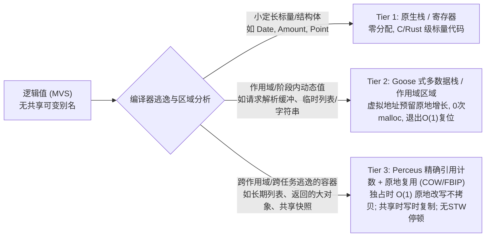
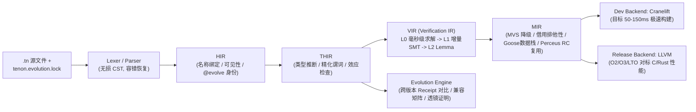

# 05 — 内存模型、并发、元编程与编译器工程实现路线

> 本章把 [`lang-research`](../../lang-research) 中所有关于内存模型、数据栈、Perceus 复用、混合栈实验的实测结论，与 [`loom-lang`](../../loom-lang) 的工程教训整合为一套可落地、分阶段、可证伪的编译器与运行时实现方案。  
> **效率标杆**：开发期编译速度对标 **Go / Zig**，生产期执行性能对标 **Rust / C**。

---

## 1. 内存模型：无生命周期地狱、无别名污染、无 STW 停顿

### 1.1 语言层语义：默认可变值语义（MVS）+ 局部 `inout`

借鉴 **Hylo**（可变值语义）与 **Gojo**（无生命周期标注借用），Tenon 在源码层只有极简的三条规则：

1. **所有普通值（标量、结构体、枚举、`Text`、`List`、`Map`）均为逻辑值语义**：
   - 赋值 `let b = a` 在逻辑上产生独立值，修改 `b` **永远不会**影响 `a`；
   - **零共享可变别名**——这不仅消除了大量并发和数据篡改 Bug，更直接让第 03 章的形式化验证引擎复杂度下降 10 倍！
2. **原地修改通过调用点显式 `inout` 表达（零 `'a` 生命周期标注）**：
   - 普通参数默认只读借用（编译器决定按值传寄存器还是传只读指针）；
   - 需要修改时声明 `fn push(inout xs: List[T], item: T)`，调用时写 `push(&xs, x)`（或方法语法 `xs.push(x)`）；
   - 编译器采用静态局部排他性检查（Law of Exclusivity，类似 Swift/Hylo/Gojo）：同一调用中不能把同一变量（或其重叠子路径）同时传给两个 `inout` 参数，但**完全不需要在结构体或泛型签名上写任何 `'a` 生命周期参数**（因为借用不能逃逸存入普通结构体）。
3. **显式转移 `move` / 自动最后使用消费（Last-Use Move）**：
   - 编译器自动执行最后使用分析（Liveness / Last-Use Analysis）：当 `a` 在赋值或传参后不再被读取时，直接零拷贝转移所有权，程序员无需满屏手写 `.clone()` 或 `^`。

### 1.2 运行时三层混合存储引擎（直接落地 `lang-research` 结论）

逻辑上是纯值语义，不等于运行时满地拷贝！Tenon 编译器在 MIR 阶段自动把逻辑值映射到**三层高效物理存储**：

- **Tier 1（原生栈/寄存器）**：像 `Date { year, month, day }`、`Amount`、`Option[Int]` 这类值直接拆箱进寄存器或栈槽，精化谓词在编译期证明后**完全擦除（零字节额外元数据开销）**。
- **Tier 2（Goose 式编译器多数据栈）**：
  - 吸收 `lang-research` 中 `goose-stacks`、`portable-data-stack-storage` 与 `stack-growth` 的实测成果：
  - 64 位带 MMU 平台使用虚拟地址预留 + 按需提交 + 空闲整页归还（`madvise` / `MEM_RESET`），实现变长缓冲区增长不搬迁、指针递增分配、作用域退出 O(1) 复位；
  - 无 MMU 嵌入式/受限目标优雅降级为有界分块区域（Segmented Arena）。
- **Tier 3（Perceus 精确引用计数 + 唯一引用原地复用）**：
  - 吸收 `lang-research` 中 Koka/Lean `memory-models` 实验结论：
  - 逃逸的大容器（`List`/`Map`/`Text`/ADT 树）底层由精确引用计数缓冲区支撑；
  - 当 `refcount == 1`（单拥有者，绝大多数业务代码热路径！）执行 `xs.push(v)` 或树节点变换时，**直接原地修改与槽位复用，零内存分配、零拷贝**；
  - 仅当逻辑上真正存在多份值快照（`let snap = xs; xs.push(v)`）时，才在写入点触发一次延迟写时复制（COW），同时保持历史快照 `snap` 绝对不可变（极适合多线程零拷贝只读共享和事务回滚！）；
  - 因为普通值语义是严格无环的（DAG），**Perceus 引用计数天然不会产生循环引用泄漏，彻底告别 STW 追踪式 GC！**

### 1.3 长期可变对象图与循环引用：`Store[T]` 显式边界

遵循 `lang-research/research/region-reclamation-designs.zh-CN.md` 的设计结论：当程序确实需要表达**长期独立增删、带环的复杂对象图**（如图数据库、DOM/AST 编辑器、游戏实体 ECS、图缓存）时，不破坏全局 MVS，而是使用标准库+编译器协同检查的显式 **`Store[T]`**：

- **`Handle[StoreTag, T]`（带代次可验证句柄）**：包含槽位索引 + 不可回绕代次（Generation，耗尽后冻结该槽位复用，杜绝 ABA 身份冒充）；
- **短访问阶段 `phase(store)`**：在阶段内经句柄查得高效物理视图，编译器静态禁止视图逃逸出阶段、禁止携带活视图 `.await` 挂起；结构性删除/压缩推迟到阶段结束统一提交；
- **声明式拥有/观察关系**：支持显式级联删除策略（如文档拥有子节点，光标仅通过句柄观察节点）。

### 1.4 资源清理与内存回收彻底正交

- 外部系统资源（文件句柄、TCP 连接、数据库事务、互斥锁）标记为 **`linear` / `MustUse`**（借鉴 `Gojo` 与 `loom-lang`），通过词法 `scoped` / `defer` 保证在正常返回、错误传播（`?`）与任务取消路径上严格 LIFO 确定性清理，绝不依赖内存回收时机。

---

## 2. 显式效应系统与结构化并发

### 2.1 轻量级效应追踪（为验证、CTFE、演化与 AI 审计提供清晰边界）

借鉴 **Koka**、**Jacquard** 与 **Loom**，函数默认只要求在需要纯净性或隔离能力时关注效应，支持**局部效应推断 + 公开 API 显式效应签名**：

| 效应标记 | 含义 | 对验证与编译器的意义 |
| --- | --- | --- |
| `pure` | 无外部 I/O、无非确定性、无全局状态读写（允许局部 `var`/局部栈分配） | **可直接在精化谓词、CTFE、L0/L1/L2 证明中调用** |
| `io[Cap]` | 显式声明所需外部能力（`Fs` / `Net` / `Clock` / `Db` / `Env`） | 防止第三方依赖或 AI 生成代码偷跑隐蔽 I/O；易于依赖注入与确定性回放测试 |
| `async` | 可能挂起等待异步完成 | 配合结构化并发与防持锁/防 `phase` 挂起静态检查 |
| `unsafe` | 越过安全边界（C FFI / 裸指针） | 严格隔离并记入 Build Receipt 审计清单，禁止未经审查污染 `proved` 证明闭包 |

### 2.2 结构化并发：天然数据竞争自由

因为普通数据默认 MVS（逻辑不可共享可变），Tenon 的并发模型异常清爽：
- **不可变快照零拷贝跨核共享**：把一个大 `List` 或只读配置传给 16 个并行子任务，底层仅增加一次原子引用计数（或结构化 `scope` 汇合点免计数借用，参考 `beyond-goose` 的有界冻结共享），**零深拷贝、编译期 100% 无数据竞争**；
- **整块区域转移（Whole-Region Transfer）**：在任务边界通过 `move` 移交整个封闭数据区域的所有权，零拷贝切换工作线程；
- **结构化任务组 `task.scope`**：所有子任务必须在作用域结束前汇合或取消并完成资源清理，杜绝野协程泄漏；
- **协程执行机制选型（结合 `lang-research/experiments/go-hybrid-stack-2026-11-20` 实测）**：
  - 方案 A（推荐首版）：**栈式混合协程（Pooled Small Stack + 虚拟内存原地增长）** —— 借鉴 Go 与 `go-hybrid-stack` 实测成果，彻底消除 `async/await` 函数染色痛点（类似 Gojo / Hylo 方向），高并发 I/O 友好；
  - 方案 B（备选/嵌入式无 MMU）：**无栈状态机（Stackless MIR Lowering）** —— 类似 Loom/Rust，内存占用极致紧凑且不依赖虚拟内存页提交。
  - *(具体采用方案 A 还是双模式支持，列入 README 待讨论决策项)*

---

## 3. 编译期计算与零反射元编程

Tenon 提供克制、类型安全、可追踪构建输入的编译期能力（吸取 Loom 与 Mojo/Goose 经验）：
- **`comptime` 纯求值**：任何 `pure` 函数均可在编译期运行（驱动 `Date` 字面量验证、常量表构建、正则 DFA 编译）；
- **只读结构反射（Schema Reflection）**：遵守模块 `pub` 可见性规则，允许遍历结构体字段名、稳定 `@field(N)` ID、类型、以及精化谓词的规范化 IR（PNF），**用来在标准库中纯源码编写**：
  - 零反射开销的 JSON / Protobuf / Binary / SQLite / Postgres 编解码器；
  - 自动 SQL `CHECK` 与 OpenAPI / JSON Schema 导出器；
  - 测试桩与属性测试（Property-Based Testing）生成器（自动根据精化约束生成合法/边界用例！）。
- **受控构建输入**：任何编译期文件读取必须通过 tracked input API，自动纳入增量编译缓存键与 Build Receipt，绝不允许 `comptime` 隐藏任意网络或环境 I/O。

---

## 4. 编译器架构与工程实现方案

### 4.1 为什么初期用 Rust 实现，暂不急于自举？

- `loom-lang` 证明了自举可行，但也证明了**在核心内存模型、验证分层与演化演算尚未定型前过早自举，会把每次底层语义实验的修改成本放大 3–5 倍**。
- 因此 Tenon 初期采用 **Rust** 实现核心编译器（充分利用 Rust 的类型安全、成熟生态：`salsa` 增量查询框架、`cranelift`、`inkwell`/LLVM、Z3/CVC5 协议驱动、高性能并行数据结构），同时保持清晰的 IR 边界，**待 M3 语义彻底稳定后再评估自举（M4+）**。

### 4.2 Query-Based 增量编译器与分层 IR 流水线

**关键架构亮点**：
1. **单前端多消费（Query-Based / Salsa 风格）**：CLI、LSP/VS Code 扩展、格式化器、验证器、`tenon evolve` 全部共享同一份增量查询数据库。修改函数体内部实现而不改签名/精化谓词时，**下游调用者和依赖方的类型检查与 SMT 证明零重跑**！
2. **双后端分工明确**：
   - `tenon check`：只跑到 VIR（L0 默认全跑，L1 走缓存/增量），目标热编辑 **< 50ms**；
   - `tenon test` / `tenon run`（默认 Dev）：走 **Cranelift**（类似 Zed，或前期辅助 C/QBE），目标小程序构建 **< 150ms**（追平 Go/Zig）；
   - `tenon build --release`：走 **LLVM** 全量优化，自动消除已证明的精化/边界/溢出检查，输出与 C/Rust 持平的原生二进制 + 完整 **Build Receipt**。
3. **验证与代码生成彻底解耦**：发出的生产二进制**零求解器依赖**（绝不链接 Z3）。

---

## 5. 分阶段实现路线（M0 → M4）与可证伪验收门禁

借鉴 `loom-lang` 的“完整验收故事（Acceptance Stories）”与 `lang-research` 的“可复现基准纪律”，每个阶段必须通过具体、可证伪的端到端程序与对抗测试，不允许只做孤立语法演示：

### M0 — 极简核心与 L0 精化类型闭环（预计 6–8 周）
- **交付物**：
  - Lexer / Parser / HIR / THIR / VIR(L0) + Cranelift 后端最小闭环；
  - 标量精化（`Amount > 0`、`Odd`/`Even`、`Aligned[N]`）、流敏感精化、跨字段结构体（完整支持 **`Date` 含闰年校验**、`DateRange`）、`mutate` 原子修改块；
  - L0 进程内求解器（区间 + 同余 + Octagon + 有界 CTFE），自动生成 `.parse()` 边界解析器；
  - 零外部依赖运行 `tenon check / test / run`。
- **可证伪门禁**：
  - `Date { 2024, 2, 29 }` 静态零检查通过；`Date { 2023, 2, 29 }` 编译期报错并指出 `29 <= 28`；
  - `add_odds(Odd, Odd) -> Even` 与 `div_exact(a, NonZero)` 零 Z3 毫秒级通过且生成汇编无冗余检查；
  - 5,000 万步 `xorshift32` 与 `Date` 批量校验微基准建仓并接入 C/Rust/Go/Zig 自动对照脚本。

### M1 — L1 增量 SMT 契约 + MVS/Perceus 内存引擎（预计 8–10 周）
- **交付物**：
  - 常驻增量 Z3 引擎 + Canonical VC 内容缓存 + 源码级反例反演器 + JSON 诊断协议（AI Vericoding 就绪）；
  - 完整 `requires` / `ensures` / `old()` / 显式效应（`pure`/`io`/`unsafe`）+ 严格 Fail-Closed 门禁；
  - MVS + `inout` 排他性检查 + **Perceus 精确引用计数与唯一引用原地复用**（实现 `List` / `Text` / `Map` / ADT）；
  - 编译期只读反射 + 自动派生 JSON 编解码与 SQL `CHECK` 约束。
- **可证伪门禁**：
  - 独占 `List` 转换基准插桩验证 **0 次多余堆拷贝/重分配**，共享快照写入自动 COW 保护原快照；
  - 完整证明复式记账凭证不变量、带闰年边界的 `add_one_year(Date)` 反例自动发现与修复；
  - 100+ 对抗性负例（伪造精化、绕过 `mutate`、违规跨别名 `inout`、SMT 超时尝试放行）100% 拒绝。

### M2 — 系统级版本演化与兼容性推导引擎（预计 8–10 周，核心里程碑！）
- **交付物**：
  - `@evolve` / `@field(N)` 语义身份 + `tenon.evolution.lock` + 不可变 Build Receipt；
  - `tenon evolve check`：基于 L0+L1 SMT 自动输出 **Storage / Wire / API** 三维兼容性矩阵、精确反例与残差域 $\Delta$；
  - 一等 `evolution V1 <-> V2` 双向透镜语法，编译器静态证明 **Totality / Round-Trip / Retained Re-Upgrade** 定律；
  - `std.evolve` 通用 SQLite / PostgreSQL 执行器（Append-Only 部署账本、精准残差回填、在线 Expand-Contract 兼容层、故障注入与未知回执保护）。
- **可证伪门禁**：
  - **端到端场景 1（金额收紧 + 新增表）**：完整自动跑通 `v1 (amount >= 0) → v2 (amount > 0 + note) → 降级回 v1（保留 note + v1 继续编辑与新插 0 金额）→ 故障注入中断恢复 → 再升级回 v2` 全生命周期，无硬编码表名；
  - **端到端场景 2（闰年修复）**：自动发现 `Date` v1→v2 的残差反例 `1900-02-29` 并强制覆盖；
  - **端到端场景 3（API 行为子类型）**：自动识别 `requires` 放宽 + `ensures` 收紧为兼容升级，识别 `pure` 变 `io` 或 `ensures` 弱化为破坏性变更。

### M3 — 高性能系统层深化：Goose 多数据栈 + `Store[T]` + 结构化并发 + LLVM Release（预计 10–12 周）
- **交付物**：
  - 引入 **Goose 式编译器多数据栈（Tier 2）** 优化请求/解析/批处理流水线（虚拟地址预留原地增长 + 无 MMU 分块回退）；
  - 引入 **`Store[T] + Handle + phase`** 支持长期可变图与安全独立删除；
  - 引入结构化并发、异步网络 I/O（TCP/TLS/HTTP）与 L2 `ghost`/`lemma`/`decreases`（端到端证明排序有序+置换与终止性）；
  - 接入 **LLVM Release 后端**与完整 LSP/VS Code 插件。
- **可证伪门禁**：
  - 解析/记录流水线在 Tier 2 数据栈工作区间达到接近 0 次 `malloc`；
  - Release 性能追平 C/Rust（偏差 ≤ 5%），Dev 单文件增量构建追平 Go/Zig（< 200ms）；
  - 真实并发 HTTP 服务在线滚动升级（V1/V2 混合流量共存 + 数据库实时迁移 + 零请求失败）端到端通过。

### M4 — 生态固化、极小验证内核证书与自举评估
- 探索将关键 L1/L2 证明导出至独立极小核验内核（降低 TCB）；
- 完善包管理器（与 `evolution check` 深度结合：依赖升级直接展示语义破坏报告而非只看 SemVer！）；
- 在核心语义、验证与演化模型经过多个真实生产服务打磨稳定后，决定是否将编译器前端分阶段迁移至 Tenon 自举。
