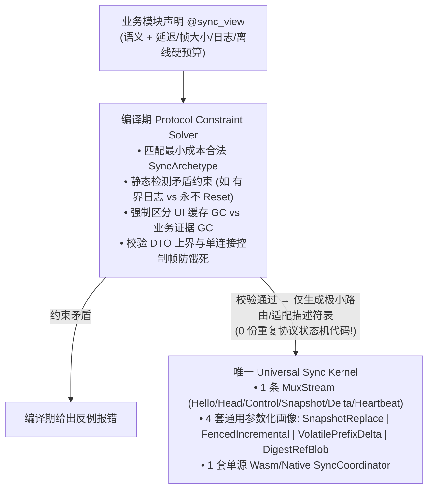
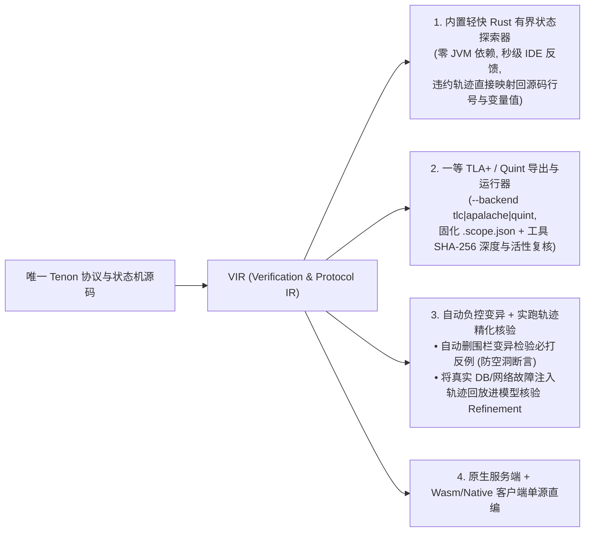

# 06 — 调和状态机形式化、分布式同步协议推导与通用微内核演化

> **定位（依据 [ADR-0001 (D02, D06, D07, D10, D12)](adr/0001-architecture-decisions.md) 定稿）**：  
> 语言核心保持极简通用（仅内建精化、MVS/线性令牌、显式效应、协议公理钩子、`comptime` 特化与 `@evolve`）；本章所有三轴调和、锁序格、双围栏 Attempt、通用同步微内核（`SyncArchetype`）均作为**标准库一等可验证协议模板（`std.reconcile` / `std.sync`）**实现，采用统一 `loom/Go` 简洁语法，直接对接 [`dast-os-kernel`](../../../dast.ai/dast-os-kernel/README.md) 级分布式系统需求。

---

## 1. 从 `dast-os-kernel` 提取的真实系统第一性原理

| `dast-os-kernel` 的架构铁律 | 原 Go + TLA+ 的实现代价 | Tenon 极简核心 + 标准库模板的破局点 |
| --- | --- | --- |
| **正交三轴状态**（`Intent × Authority × Observed`） | 靠 `AGENTS.md` + `state-machines.json` 人工审阅 | 标准库 `ReconciledEntity` 模板 + 能力域字段写隔离，越权写编译期报错 |
| **三窄写入接口**（`AuthorityTxn` / `EffectPort` / `ReceiptPort`） | 靠包边界单测与 DB 角色反复审计旁路 | 显式能力效应类型直接锁死写入入口 |
| **六级全局物理锁序**（`LockClass`） | 靠 `LockOrder.tla` 抽样与手工核对 | 类型级锁序格 `AuthorityTxn[Held]`，反向取锁 L0 编译期拒绝 |
| **防 ABA ACK（C05）与锁内授时（C07）** | 人工审查是否读前固定版本、是否错用锁前时钟 | 线性快照令牌 `ObservedDirty[E, R]` + `distinct type LockedMonotonicNow[Txn]` |
| **Attempt 双围栏 + 未知恢复（R0–R5）** | 手写状态机 + 17 个 TLA+ 切片（仍可能与 Go 漂移） | `linear AdmittedAttempt` + 双引擎同源 `tenon modelcheck` 与实跑轨迹精化核验 |
| **分布式同步分层**（`docs/11` & `docs/13`） | Go/React/Swift/Android 四端手抄同步协调器与背压/GC | 声明式视图+预算 → 约束求解绑定 **1 套通用参数化 `SyncKernel` + 4 种可扩展 `SyncArchetype`** + Wasm/Native 单源编译 |
| **少版本化演进**（`docs/10`：`required ⊆ supported`） | 手工维护能力表、位图、领取/提交双重检查 | 与第 04 章融合，编译器自动推导能力子集并生成 Claim/Commit 双门禁 |

---

## 2. 标准库调和原语：三轴实体、锁序格、防 ABA 令牌与线性 Attempt

```tenon
// 1. 声明全局物理锁序格（利用语言核心的序约束与精化，编译期强制全序）
pub lock_lattice KernelLocks {
    L1_ConnectorSession < L2_Payer < L2_BudgetPermit
                        < L3_Control   // Session / Task / Matter
                        < L4_Authority // Connection / Grant / Source / Subscription / Runtime / Wait
                        < L5_Conflict  // ConflictControl -> Attempt -> Receipt
                        < L6_Index     // Dirty -> Due -> Outbox -> ProjectionHead
}

// 2. 三轴正交受管实体（name Type，无冒号）
@reconciled(lock_class = KernelLocks.L4_Authority.Source,
            conflict_key = (self.provider, self.external_resource_id))
pub record EventSource {
    @axis(Intent) {
        lifecycle    Lifecycle             // Active | Paused | Cancelled | Retired
        desired_mode AcquisitionMode
        rev          MonotonicU64          // 严格单调递增，禁止回退或归零
    }
    @axis(Authority) {
        auth_gen     NonZeroMonotonicU64   // 类型级永不归零（消灭解绑归零 ABA！）
        grant        GrantProof
    }
    @axis(Observed) {
        remote_watch Option[RemoteWatchHandle]
        last_error   Option[StructuredError]
    }
    invariant self.lifecycle == Lifecycle.Cancelled => !can_admit_business_effect(self)
}
```

### 编译期消除四类经典并发/分布式 Bug

```tenon
// A. 静态锁序格：反向取锁直接 L0 编译报错
pub fn lock[comptime Next LockLevel, E EntityAt[Next]](
    inout txn AuthorityTxn[Held],
    key E.Key
) (AuthorityTxn[Next], LockedRow[E])
    requires Next > Held

// B. 防 ABA 消费确认：只接受本次快照绑定的线性令牌，拒绝外部 TriggerMeta.dirty_hint
let (snap, dirty_token) = txn.read_with_dirty(key)
txn.ack_dirty(move dirty_token)

// C. 锁内单调授时隔离：SchedulerObservedTime 与 LockedMonotonicNow[Txn] 互不兼容
pub fn settle_wait(inout txn AuthorityTxn[L], now LockedMonotonicNow[L], inout w MatterWait)

// D. 线性 Attempt 与双围栏：Unknown 禁止释放 conflict_held 或盲目重发
let attempt linear AdmittedAttempt[WatchOp] = txn.admit_attempt(
    locked_source, source.conflict_key, WatchOp.Start, None
)
match effect_port.execute(move attempt) {
    EffectOutcome.Confirmed(raw_fact) => {
        let saved = receipt_port.append(raw_fact)  // 仅 Cap[AppendReceipt]，无法改 Intent/清 hold
        authority_txn.apply_receipt(saved)         // 围栏 A 存事实；围栏 B 遇 Cancelled 转交补偿 hold
    }
    EffectOutcome.DefiniteFailed(err) => authority_txn.settle_failed(err)
    EffectOutcome.Unknown(pending_id) => authority_txn.record_unknown_hold(pending_id)
}
```

---

## 3. 从声明式状态与性能/数据量约束，推导出极简通用的分布式同步协议

坚决避开两个陷阱：**绝不为 30 个业务模块推导生成 30 套私有协议**，也**绝不把高频 Token、持久列表、业务证据强塞进同一种范式**。

Tenon 的架构是 **“1 套极简通用参数化同步微内核（`SyncKernel` + 单条 `MuxStream` + 单源 Wasm/Native `SyncCoordinator`）+ 4 种标准库可扩展已证明画像（`SyncArchetype`）+ 编译期约束求解器”**：



### 3.1 声明式视图与硬预算示例（`loom/Go` 语法）

```tenon
// 1. 小型时间敏感投影 → 编译器自动推导绑定 SnapshotReplace (ETag + validUntil)
@sync_view("device.surface")
view DeviceSurfaceView from DeviceStateAuthority {
    scope      = (deploy_id, principal, env, device_id)
    authority  = ReadOnlyProjection
    freshness  = ValidUntil(min_trigger_at(items))
    durability = Reconstructible
    bounds {
        max_items        = 64
        max_payload      = 64 KiB
        max_frame        = 64 KiB
        offline_recovery = FullReplace
    }
    pure fn fold(auth DeviceStateSnapshot) DeviceSurfaceDTO { ... }
}

// 2. 有界大型列表 → max_payload > max_frame 自动推导绑定 FencedIncremental (首分页 fence + changes + 410 reset)
@sync_view("tasks.list")
view TasksListView from TaskAuthority {
    scope      = (deploy_id, principal, view_profile)
    authority  = ReadOnlyProjection
    durability = Reconstructible
    bounds {
        max_items        = 1_000
        max_payload      = 16 MiB
        max_frame        = 4 MiB
        max_delta_batch  = (100 items, 2 MiB)
        journal_budget   = (256 batches, 16 MiB)
        offline_recovery = BoundedReset           // 若误写 NeverReset，L1 直接报与 journal_budget 矛盾！
    }
    pure fn fold_item(task TaskRow) TaskSummaryDTO { ... }
}

// 3. 极高频易失 Token 流 → 自动绑定 VolatilePrefixDelta (0 次 DB 写 + 慢端丢帧 + 丢尾 high-water 自愈)
@sync_view("session.active_stream")
view ActiveTokenStream from EffectStreamProducer {
    scope      = (deploy_id, principal, session_id, stream_id)
    authority  = VolatileOverlay(heal_from = SessionTranscriptView)
    durability = Volatile
    bounds {
        db_writes_per_delta  = 0
        per_conn_queue       = (256 frames, 1 MiB)
        gateway_mem_budget   = 64 MiB
        slow_consumer        = DropAndSignalResync
        tail_loss_healing    = HighWaterHeartbeat + TerminalSnapshot
    }
}
```

### 3.2 编译期自动拦截的 7 类分布式协议反模式

1. **有界日志 vs 永不 Reset 矛盾**：`journal_budget` 有限却声明 `NeverReset` → L1 直接报错；
2. **DTO 击穿帧预算**：DTO 含无界 `Text`/`Bytes` 却未加 `BoundedText[N]` 精化或外置为 `ArtifactRef` → L0 报错；
3. **易失数据污染权威决策**：任何 `AuthorityTxn`（批准、计费、完成裁决）引用 `Volatile` 视图数据 → 效应/污点类型直接拒绝；
4. **控制帧被 Token 洪峰饿死**：静态核验单连接 `MuxStream` 唯一 writer 隔离槽位，`needsResync` 绝不回填进已满的 Delta 队列；
5. **两类 GC 混用**：试图给 `AuthoritativeEvidence`（Attempt/Receipt/Outbox/DeviceJournal）配无截止证明的 TTL 清理 → 编译期拒绝；
6. **权限撤销缓存穿透**：引用 `Grant` 保护数据的视图自动将 `auth_gen` 纳入缓存键与读前水位检查；
7. **无正文 304 与旧代次覆盖**：协议模板 `laws` 强制清空缓存时同步废止 ETag，并强制回调校验 `local_gen` 与 `epoch`。

---

## 4. 协议自身可扩充：标准库一等 `protocol SyncArchetype`

同步画像不写死在编译器源码中，而是用标准库一等可验证协议模板定义：

```tenon
pub protocol SyncArchetype FencedIncremental[V SyncViewSchema]
    // 1. 声明满足的约束空间（供编译器 Constraint Solver 匹配）
    satisfies {
        V.authority        == ReadOnlyProjection
        V.durability       == Reconstructible
        V.max_payload      >  V.max_frame
        V.offline_recovery == BoundedReset
    }
    // 2. 模块只需提供的极小纯适配算子（零协议状态机重复代码！）
    requires adapter {
        type Key     OrderedStableKey
        type ItemDTO BoundedSize[V.max_item_bytes]
        pure fn fold_delta(diff V.SourceDiff) Batch[Upsert[ItemDTO] | Remove[Key] | Delete[Key]]
    }
    // 3. 协议自身的形式化安全与活性公理（由 tenon modelcheck 一次性验证，全部适配模块自动继承！）
    laws {
        fault_model { crash, network_reorder, duplicate, drop_last_frame, journal_gc, epoch_switch }

        invariant publish_atomic:
            client.active_checkpoint >= max_observed_rev(client.staging)
        invariant no_silent_gap:
            req.checkpoint < server.floor => resp == SyncResp.ResetRequired
        invariant generation_fence:
            apply.local_gen == client.local_gen && apply.epoch == client.epoch
        eventually liveness_converges under fair_delivery:
            client.online => eventually(client.active_checkpoint >= server.committed_head)
    }
{
    server_handler { ... }
    client_reducer { ... } // 单源编译到 Web Wasm (+薄 TS) 与 iOS/Android/Desktop Native C-ABI (+薄 Swift/Kotlin)
}
```

未来需要新通用协议（如多端离线协同编辑 `DeltaCRDT`），只需在标准库新增并通过 `laws` 验证，所有匹配约束的模块即可零胶水复用，核心始终极简。

---

## 5. 双层自演化：静态精化透镜 + 少版本化能力子集（`dast-os-kernel/docs/10`）

1. **普通发布不升对象版本**：编译器从源码按 `read` / `execute` / `settle` / `write` 四个正交职责自动推导 `required(record, op)` 与 `supported(consumer, op)`（核心累计能力自动压缩为 `implementedThrough >= requiredLevel`，正交扩展自动投影为不可复用 bit 槽位）；
2. **双门禁自动注入**：在 **Claim（路由）** 与 **Commit（锁内当前策略复验）** 两处自动生成 `required ⊆ supported` 检查；
3. **新旧混跑乘积模型检验**：当通用 `SyncArchetype` 本身新增可选能力扩展时，`tenon modelcheck` 自动检验 `NewServer × OldClient` 与 `OldServer × NewClient` 乘积状态机是否仍保持原 `laws`，通过后才签发 `RollingCompatible` 构建回执。

---

## 6. 双引擎同源协议验证（`tenon modelcheck`，[ADR-0001 D10](adr/0001-architecture-decisions.md)）

彻底终结“Go 业务代码 vs TLA+ 形式模型两张皮”：



### 诚实边界
1. 有限状态模型检验不替代无界规模压测与真实 SQL 隔离/尾延迟验收（`SYNC-C01 ~ C08` 仍需真实并发夹具复跑）；
2. 上游外部系统行为（Provider 是否真不轮换令牌、OS 通知撤回、磁盘 `fsync`）显式标注为 `assumed` 环境契约，绝不伪装成 `proved`。
