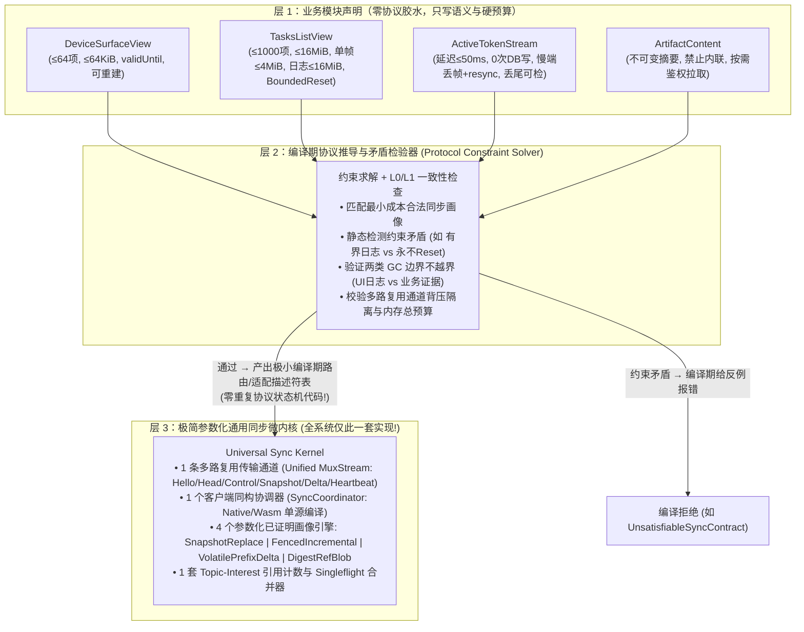
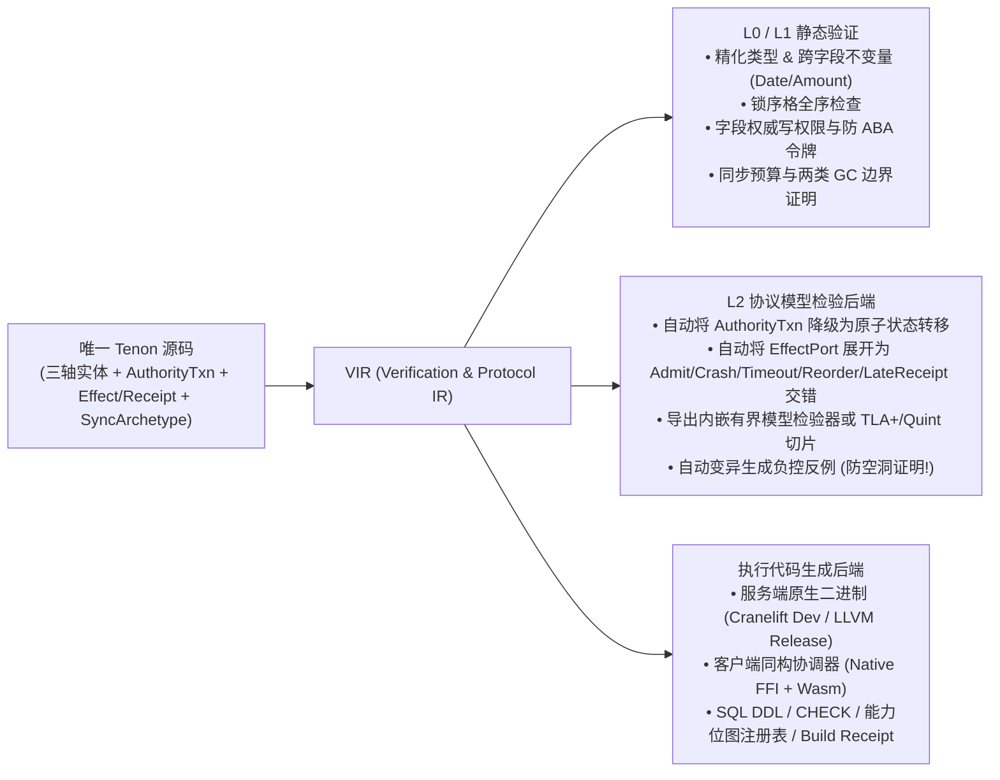

# 06 — 调和状态机形式化、约束驱动分布式同步协议推导与通用微内核演化

> **上游真实系统锚点**：深度复盘 [`dast-os-kernel`](../../../dast.ai/dast-os-kernel/README.md)（云端 AI Agent 调和式 OS 内核，含 `docs/00–13`、227 轮跨层审计、17 个 TLA+ 形式模型 / 113 项 TLC 配置、Go/SQLite/PG/NATS/K8s/macOS 验证路径）。  
> **核心问题**：当一个语言要原生支撑像 `dast-os-kernel` 这样的复杂分布式调和系统时，如何：
> 1. 把**正交三轴状态、锁序、双围栏、Attempt 未知恢复、防 ABA ACK、锁内授时**直接沉淀进语言类型与效应系统（消灭手工审阅与代码/TLA+ 两张皮）；
> 2. 从**声明式状态意图 + 性能/数据量硬预算约束**出发，编译推导并形式化验证分布式同步协议；
> 3. **保持核心极简、通用、可扩充**——只维护一套参数化通用同步微内核供各模块零胶水适配，绝不退化为“每个模块推导出一堆割裂的专有实现”。

---

## 1. 从 `dast-os-kernel` 提取的真实系统第一性原理

`dast-os-kernel` 在历经多代演进与 227 轮严格审计后，收敛出了一套极其精炼的分布式系统架构规律，但也暴露出用传统命令式语言（Go + SQL + 外挂 TLA+ + 人工清单）实现它的巨大摩擦成本：

| `dast-os-kernel` 的架构铁律 | 当前 Go + TLA+ 的实现代价 | 语言层原生支持的突破方向 |
| --- | --- | --- |
| **正交三轴状态**（`Intent × Authority/Fact × Execution/Observed`，禁混合 `status` 枚举） | 靠 `AGENTS.md` 纪律 + `state-machines.json` 清单 + 人工代码审阅 | **一等 `reconciled entity` 三轴声明 + 能力作用域字段写权限**，编译期静态禁止越权写与复活取消意图 |
| **三窄写入接口**（`AuthorityTxn` / `EffectPort` / `ReceiptPort`） | 靠包可见性、架构单测、DB 角色隔离反复审计旁路 | **效应与能力类型（Capability Types）** 直接锁死三个入口，非持有对应能力令牌根本无法编译 |
| **六级全局物理锁序**（`LockClass` Registry） | 靠 `LockOrder.tla` 抽样 + 手工检查每条 handler 锁序 | **类型级锁序格 `Txn[MaxHeldLevel]`**，反向取锁在 L0 编译期直接报错，零运行时开销 |
| **防 ABA 消费确认（C05）与锁内授时（C07）** | 靠审阅检查“是否在读状态前固定 dirty rev”“是否误用锁前时钟” | **快照绑定令牌 `ObservedRev[E, R]` + 独立类型 `LockedMonotonicClock[Txn]`**，错用即类型错误 |
| **Attempt 双围栏 + 未知结果恢复（R0–R5）** | 手写状态机 + 17 个 TLA+ 切片维持同步，但模型通过 ≠ Go 实现正确 | **线性协议令牌 `AdmittedAttempt` + 四态强制分支 + 单源双编译（原生执行 + 模型检验导出）** |
| **分布式同步分层**（`docs/11` & `docs/13`：权威态 / 小快照 / 有界增量列表 / 易失流 / 不可变 Blob，共享 1 条 SSE 与 1 个客户端协调器） | 手工在 Go / React / Swift / Android 维护多份一致的协调器、背压预算、丢尾自愈与两类 GC | **声明式 `@sync_view` + 资源/延迟硬预算 → 编译器推导选定通用已证明画像 → 装配进唯一通用 `SyncKernel` 与跨端同构协调器** |
| **少版本化演进**（`docs/10`：`required(record, op) ⊆ supported(consumer, op)`，不按 build 升全局版本号） | 手工维护能力注册表、位图编码、领取与提交双重校验 | **与第 04 章演化演算融合**：编译器从类型/精化变化自动推导能力集与双检查点，自动派生旧端投影 |

---

## 2. 语言层形式化一：三轴状态、锁序、时钟与调和代数

### 2.1 一等三轴受管实体（Orthogonal Reconciled Entity）

在 Tenon 中，受调和内核管理的状态不再是一个平铺的 `struct`，而是带**正交轴边界、物理锁级和单调代数类型**的一等声明：

```tenon
// 内核注册的全局物理锁序格（编译期全序，禁止 handler 自定义逆序）
pub lock_lattice KernelLocks {
    L1_ConnectorSession < L2_Payer < L2_BudgetPermit
                        < L3_Control   // Session / Task / Matter（含祖先，固定唯一类别）
                        < L4_Authority // Connection / Grant / Source / Subscription / Runtime / Wait
                        < L5_Conflict  // ConflictControl -> Attempt -> Receipt
                        < L6_Index     // Dirty -> Due -> Outbox -> ProjectionHead
}

// 一等三轴实体：Intent / Authority / Observed 字段权威由类型系统强制隔离
reconciled entity EventSource
    lock_class   = KernelLocks.L4_Authority.Source
    conflict_key = (self.provider, self.external_resource_id)
{
    intent {                                   // 仅 Cap[WriteIntent] 可修改
        lifecycle:    Lifecycle,               // Active | Paused | Cancelled | Retired
        desired_mode: AcquisitionMode,
        rev:          MonotonicU64,            // 编译器强制严格单调递增，禁止回退或归零
    }

    authority {                                // 仅 Cap[WriteAuth] + 外部/本人证明可修改
        auth_gen:     NonZeroMonotonicU64,     // 类型级保证永不归零（消灭解绑归零 ABA！）
        grant:        GrantProof,
    }

    observed {                                 // 仅由调和结算 / Receipt 应用更新
        remote_watch: Option[RemoteWatchHandle],
        last_error:   Option[StructuredError],
    }

    // 结构级调和不变量（由 L1 SMT 与 L2 模型检验共同保障）
    invariant self.intent.lifecycle == Lifecycle.Cancelled
              => !can_admit_business_effect(self)
}
```

### 2.2 编译期消灭四类经典并发/分布式 Bug

通过把 `dast-os-kernel` 的核心不变量编进**线性/精化/能力类型**，四类在 Go 中只能靠人工审阅和 TLA+ 抽检的致命缺陷在 Tenon 中直接变成**编译错误**：

1. **静态防死锁锁序检查（替代手工审阅 `LockOrder`）**：
   ```tenon
   // 事务句柄类型携带当前已持最高锁层级 L
   pub fn lock[Next: LockLevel, E: EntityAt[Next]](
       inout txn: AuthorityTxn[Held],
       key: E.Key
   ) -> (AuthorityTxn[Next], LockedRow[E])
       requires Next > Held   // L0 编译期强制严格递增！同级多行须走 lock_ordered_batch
   ```
   任何试图“先锁 `Attempt(L5)` 再锁 `Source(L4)`”或“先锁 `Dirty(L6)` 再锁 `Target(L4)`”的代码**直接无法通过编译**。若发现动态足迹变化（例如解析父任务后发现新的 `Payer(L2)`），类型系统迫使代码显式 `txn.rollback_and_replan()` 释放全部锁后按新足迹重取。

2. **防 ABA 消费水位令牌（编译期强制 C05）**：
   ```tenon
   // 只有在 AuthorityTxn 快照内同时固定对象状态与 dirty_rev，才能获得 ObservedDirty[E, R]
   let (snap, dirty_token): (Snapshot[EventSource], ObservedDirty[EventSource, R]) =
       txn.read_with_dirty(key)

   // ACK 只接受本次快照产出的线性令牌，严禁接受调度器传入的 TriggerMeta.dirty_hint！
   txn.ack_dirty(dirty_token)  // 内部自动生成: WHERE dirty_revision == R（否则保留新变更）
   ```

3. **锁内单调授时类型隔离（编译期强制 C07）**：
   - `SchedulerObservedTime`（调度触发时的墙钟，仅作日志/提示）与 `LockedMonotonicNow[Txn]`（在目标行锁内读取的单调时刻）是**两个不兼容的 `distinct type`**。
   - 任何涉及竞争胜负的截止判定（如 `Wait.Until`、`Lease.Until`、`BudgetPermit.ExpiresAt`），其 API 签名强制要求 `LockedMonotonicNow[Txn]`，从语言层彻底消灭“锁前读时钟决定胜负”的竞态。

4. **线性 Attempt 协议与双围栏强制执行（编译期强制 C04 / C06 / R0–R5）**：
   ```tenon
   // 1. 接纳：必须在持有目标行锁的 AuthorityTxn 内完成，产出线性令牌 AdmittedAttempt
   let attempt: linear AdmittedAttempt[WatchOp] = txn.admit_attempt(
       target      = locked_source,
       conflict    = source.conflict_key, // 原子置 conflict_held = true
       op          = WatchOp.Start,
       retry_proof = None,                // 无安全重试证明 → unknown 时强制 fail-closed
   )
   // 2. 执行：EffectPort 无业务表写能力，仅消耗线性 attempt 令牌，强制返回三态结果
   let outcome = effect_port.execute(move attempt)

   // 3. 结算：ReceiptPort.append 仅具 Cap[AppendReceipt]，绝不能改 Intent 或清 conflict_held
   match outcome {
       EffectOutcome.Confirmed(raw_fact) => {
           let saved: SavedReceipt = receipt_port.append(raw_fact)
           // 独立 settler 经 AuthorityTxn 按 L4->L5->L6 锁序应用：
           // 围栏 A：无论当前 lifecycle 是否已 Cancelled，必须保存远端句柄事实；
           // 围栏 B：若已 Cancelled，类型系统禁止改回 Active，必须转交线性 CompensationHold！
           authority_txn.apply_receipt(saved)
       }
       EffectOutcome.DefiniteFailed(err) => authority_txn.settle_failed(err),
       EffectOutcome.Unknown(pending_id) => {
           // 编译器线性检查：禁止释放 conflict_held，禁止盲目重发！
           // 仅当提供 SafeRetryProof 或 RemoteReadbackProof 时才允许解除屏障
           authority_txn.record_unknown_hold(pending_id)
       }
   }
   ```

---

## 3. 核心架构：如何从“声明式状态 + 性能/数据量约束”编译推导出“极简、通用、可适配”的分布式同步协议？

### 3.1 破除两个设计陷阱

当语言试图支持分布式状态同步的编译推导时，存在两个必须坚决避开的极端：

- **陷阱 A（逐模块协议代码生成爆炸）**：为 `Session`、`Task`、`DeviceState`、`Attention`、`Memory` 各自推导出一套独立的网络协议、独立的长连接、独立的缓存/重试/GC 逻辑——结果必然导致连接数爆炸、慢客户端互相拖死、维护与排障失控。
- **陷阱 B（大一统单一范式抹平差异）**：把所有状态强行塞进统一 CRDT、统一 Event Sourcing 或统一全量同步——会导致高频 Token 写爆数据库、离线设备无限撑爆服务端增量日志、或者把 UI 缓存 TTL 错用到业务证据去重表上。

### 3.2 Tenon 的核心方案：声明式同步约束 → 协议画像演算 → 参数化通用微内核

Tenon 提出 **“1 套极简通用协议微内核 + 4 种正交已证明同步画像（可扩展）+ 编译期约束求解装配”** 的三层体系：



### 3.3 模块如何声明状态同步与性能/数据量硬约束？

业务模块开发者**完全不写** SSE 帧封装、ETag 比较、分页 fence、断线退避或本地事务切换，而是用极简声明描述**数据语义 + 性能/数据量约束**：

```tenon
// 1. 小型时间敏感投影（如设备表面期望、角标汇总）
@sync_view("device.surface")
view DeviceSurfaceView from DeviceStateAuthority {
    scope:       (deploy_id, principal, env, device_id),
    authority:   ReadOnlyProjection,
    freshness:   ValidUntil(min_trigger_at(items)),   // M2: 强制到期重算，禁止旧 304 伪装新鲜
    durability:  Reconstructible,                     // 可清空重建，归入 UI 缓存域
    bounds {
        max_items:         64,
        max_payload:       64 KiB,
        max_frame:         64 KiB,
        offline_recovery:  FullReplace,
    }
    fold(auth) -> DeviceSurfaceDTO { ... }            // 纯函数，编译器保证零副作用
}

// 2. 有界大型列表（如 Tasks / Todo / Memory 摘要）
@sync_view("tasks.list")
view TasksListView from TaskAuthority {
    scope:       (deploy_id, principal, view_profile),
    authority:   ReadOnlyProjection,
    durability:  Reconstructible,
    bounds {
        max_items:         1_000,
        max_payload:       16 MiB,
        max_frame:         4 MiB,                     // 小于 max_payload → 编译器自动推导不可整包推送！
        max_delta_batch:   100 items / 2 MiB,
        journal_budget:    256 batches / 16 MiB,      // 服务端有界日志预算
        offline_recovery:  BoundedReset,              // 超出 journal floor → 必须走 410 reset_required
        read_your_write:   OptionalMinSourceBarrier,
    }
    fold_item(task) -> TaskSummaryDTO { ... }
}

// 3. 极高频低延迟易失流（如 LLM Token / tool_update 增量）
@sync_view("session.active_stream")
view ActiveTokenStream from EffectStreamProducer {
    scope:       (deploy_id, principal, session_id, stream_id),
    authority:   VolatileOverlay(heal_from = SessionTranscriptView), // 声明终态自愈权威源
    durability:  Volatile,
    bounds {
        db_writes_per_delta:  0,                      // 硬约束：严禁逐 Token 写库！
        target_fanout_budget: 256 frames / 1 MiB per_conn,
        gateway_mem_budget:   64 MiB,
        slow_consumer:        DropAndSignalResync,    // 禁止反压阻塞 Worker / AuthorityTxn
        tail_loss_healing:    HighWaterHeartbeat + TerminalSnapshot,
    }
}
```

### 3.4 编译期协议推导规则与矛盾反例（Constraint-Driven Protocol Selection）

编译器中的 **Protocol Constraint Solver** 依据一组公开、确定性的**代数推导规则**把 `@sync_view` 编译为对通用内核的参数化绑定，并在编译期拦截所有隐蔽的分布式设计错误：

| 推导/检验规则 | 触发条件 | 编译期行为（自动推导或编译拒绝） |
| --- | --- | --- |
| **R1 · 画像自动推导** | `Reconstructible` 且 `max_payload ≤ max_frame` | 自动绑定 **`SnapshotReplace`** 通用引擎（整包 + `ETag` + `validUntil` + 单在途拉取合并） |
| **R2 · 增量与重置联动** | `Reconstructible` 且 `max_payload > max_frame` | 自动绑定 **`FencedIncremental`** 通用引擎（首分页 `fence H` + 连续批次 `changes` + `staging → active` 原子切换）；**强制验证**：只要 `journal_budget` 有界，就必须允许 `BoundedReset (410)`，否则直接报不可满足冲突！ |
| **R3 · 易失流安全护栏** | `durability == Volatile` | 自动绑定 **`VolatilePrefixDelta`** 通用引擎（`ActivePrefix(baseSeq)` + 顺序 `Delta` + 丢尾 `high-water`）；**强制验证**：① 必须指定 `heal_from` 持久视图；② 严禁任何 `AuthorityTxn`（批准、计费、完成判定）引用该易失视图的数据作为前提（类型级污点拦截！） |
| **R4 · 字节预算静态上界检查** | DTO 类型包含无界 `Text` / `Bytes` / 递归 `List` | 编译期 L0 核对 `sizeof_max(DTO) * max_items` 与 `max_frame`：若 DTO 含无界大字段却未转为 `ArtifactRef`（Blob 外置）或未加 `BoundedText[N]` 精化，**直接编译报错**（杜绝线上 JSON 撑爆 4 MiB 帧上限或 OOM！） |
| **R5 · 多路复用防饿死证明** | 多个视图共用 `MuxStream` | 编译器自动把所有视图的传输消息归入固定 4 类优先级/隔离槽位（`Control` / `HeadHint` 单槽合并 / `Snapshot` 替换 / `Delta` 有界队列），静态验证单连接唯一 writer 满足控制帧有界送达，且 `DropAndSignalResync` 通道绝不把 `needsResync` 放回已满的 Delta 队列 |
| **R6 · 两类 GC 边界强隔离** | 涉及保留期与清理策略 | 编译器强制区分 `Reconstructible`（走窗口/日志字节 GC，推进 `floor` 不等离线端 ACK）与 `AuthoritativeEvidence`（Attempt/Receipt/Outbox/DeviceJournal）；任何试图给 `AuthoritativeEvidence` 配置无证明 TTL 清理的代码直接编译失败 |
| **R7 · 权限撤销与缓存新鲜度** | 缓存视图引用了受 `Grant` 保护的数据 | 编译器自动把该 `Grant` 的 `auth_gen` 纳入视图缓存键与读前水位校验闭包，若某条路径漏查撤权水位直接报错 |

---

## 4. 通用协议的可扩充性：如何把协议本身也变成“可演化的标准库一等资产”？

用户提出了一个极其关键的长期架构诉求：
> “甚至是演化出通用协议但各模块可适配？通用协议的分布式系统实现也需要能够推导实现，但又保持核心的简约和可扩充，而不是一大堆每个部分都推导出的特定实现”

为了既**不把 4 种同步画像写死在编译器源码里**，又**不退化成每模块生成一套私有协议**，Tenon 把同步协议抽象为**语言内可定义、可证明、可注册的通用协议模板（`protocol SyncArchetype`）**：

```tenon
// 通用协议模板：写在标准库 std.sync 中，而非硬编码在编译器 C++/Rust 源码里！
pub protocol SyncArchetype FencedIncremental[V: SyncViewSchema]
    // 1. 声明该协议能够满足的系统级约束空间（供编译器 Constraint Solver 匹配！）
    satisfies {
        authority   == ReadOnlyProjection,
        durability  == Reconstructible,
        max_payload >  max_frame,
        offline_recovery == BoundedReset,
    }
    // 2. 声明要求业务模块必须提供的最小纯适配算子（模块只需适配，无需重写协议！）
    requires adapter {
        type Key: StableOrderedKey;
        type ItemDTO: BoundedSize[V.max_item_bytes];
        pure fn fold_delta(source_diff: V.SourceDiff) -> Batch[Upsert[ItemDTO] | Remove[Key] | Delete[Key]];
    }
    // 3. 协议自身的核心安全不变量（由 L2 模型检验器一次性证明，所有适配模块自动继承！）
    laws {
        // 绝不发布未追平 staging 观测最高版本的混合窗口
        invariant publish_atomic:
            client.active_checkpoint >= max_observed_rev(client.staging);
        // journal 超过 floor 必须 reset，绝不返回空变更假装同步
        invariant no_silent_gap:
            request.checkpoint < server.floor => response == ResetRequired;
        // 旧 epoch 或旧 localGeneration 回调绝不覆盖新镜像
        invariant generation_fence:
            apply_event.local_gen == client.local_gen && apply_event.epoch == client.epoch;
    }
{
    // 4. 协议的唯一通用分布式实现（服务端投影/分页/追平 + 客户端协调器状态机）
    //    用 MVS 纯值语义 + 显式 Substrate 效应接口编写，全系统只存在这一份实现！
    server_handler { ... }
    client_reducer { ... } // 单源编译到 Native (iOS/Android/Desktop) & Wasm (React)！
}
```

### 为什么这套设计能同时实现“简约 + 可推导 + 可扩充”？

1. **核心极度简约**：全系统运行时只包含极少的正交组件——**4 个 Substrate 接口 + 1 个统一多路复用传输层 + $K$ 个标准库通用 `SyncArchetype`（初期 $K=4$）**。新增第 31 个业务模块时，系统协议复杂度增量是 **$O(0)$**！
2. **协议本身可演化、可扩充**：
   - 当未来业务需要第 5 种通用能力（例如 **多端离线协同编辑 CRDT 画像 `DeltaCRDT`**，或 **强一致跨区读复制 `QuorumRead`**）时，架构师只需在标准库新增一个 `protocol SyncArchetype DeltaCRDT` 并通过其 `laws` 形式化验证；
   - 编译器约束求解器自动把它纳入候选协议格；以后所有声明 `writable_offline: true, conflict_resolution: CommutativeMerge` 的业务模块都能自动匹配、验证并零胶水复用它！
3. **跨端同步协调器零漂移**：`client_reducer` 是纯值语义 + 显式存储/网络效应的状态机，同一份已验证代码既可编译为桌面/移动端共享原生库（Swift/Kotlin/Desktop FFI），也可编译为 WebAssembly（React），彻底消除四端各自重抄同步状态机带来的细微差异。

---

## 5. 通用协议与模块的双层自演化：融合 `dast-os-kernel/docs/10` 的少版本化能力模型

将 `dast-os-kernel/docs/10` 的**“按职责能力子集兼容（少版本化）”**与 `tenon-lang/docs/04` 的**“SMT 精化蕴涵与双向透镜”**融合成统一的系统自演化机制：

### 5.1 为什么“全量数据版本升级”不够，必须引入“能力集合推导”？

在 `dast-os-kernel` 这样的长期运行系统中，同时存在数百万条历史 `RunProgress`、`Checkpoint`、`Attempt` 和多版本客户端（旧 iOS App、灰度中的新旧 Worker、升级中的 Gateway）。如果每次新增一个特性就升一次全局版本号并全量迁移旧记录，系统根本无法持续迭代。

因此 Tenon 把第 04 章的演化模型升级为**双层兼容演算**：

1. **静态数据结构与精化兼容（第 04 章 SMT 蕴涵）**：
   - 比较字段增删与精化谓词 $P_{V1} \implies P_{V2}$；
   - 新增非语义可选展示字段（带明确默认值）→ 编译器自动生成旧端严格 JSON 投影裁切器（`OldClientView`），**零数据迁移、普通 build 不推进业务版本**！
   - 谓词收紧（如 `amount >= 0` → `amount > 0`）→ 编译器算出残差域 $\Delta$ 并要求已证明的 `evolution V1 <-> V2` 双向透镜。
2. **动态执行与协议能力兼容（吸收 `dast-os-kernel/docs/10`）**：
   - 每个消费主体（`Reader` / `Worker` / `Settler` / `AuthorityReplica`）按**实际职责**由编译器自动从源码推导其 `supported(op)` 能力集合；
   - 每条持久工作或协议信封仅记录其**实际用到的非默认能力集 `required(record, op)`**（核心累计能力由编译器自动压缩为 `implementedThrough >= requiredLevel`，正交扩展自动分配永不复用的 bit 槽位）；
   - **编译器自动在两处生成门禁校验**：
     - **路由领取点（Claim）**：只把候选派发给满足 `required(record, execute) ⊆ supported(worker, execute)` 的节点（并采用 keyset 有界候选 + 轮转防队首饿死）；
     - **权威提交点（Commit）**：在 `AuthorityTxn` 锁内用**当前最新策略**二次重验 `required(current_policy, op) ⊆ supported(actor, op)`——即使领取时旧 Worker 合法、提交前线上开启了更严的新安全策略，旧 Proposal 也会在提交闸门被精确拦下，同时允许独立的合格 Settler 结算已发生的外部 Receipt！

### 5.2 协议演化本身的自验证（Protocol Upgrade Verification）

当通用同步协议自身演进（例如给 `FencedIncremental` 增加 `compacted_tombstone` 能力）时：
- 新能力作为一条带形式化公理的可选扩展注册进 `SyncArchetype`；
- 编译器自动检查：**不声明该能力的旧客户端连接新服务端时，协商降级路径是否仍满足原有 `laws`（如 `no_silent_gap` 和 `publish_atomic`）**；
- 只有当“新旧混跑乘积状态机（New Server × Old Client 与 Old Server × New Client）”通过 L2 有界模型检验，才允许签发 `RollingCompatible` 构建回执；否则强制要求先排空不兼容旧写者或走显式迁移！

---

## 6. 单源双编译：彻底终结“业务代码 vs TLA+ 形式模型两张皮”

回顾 `dast-os-kernel/formal/`，团队不得不维护两套完全独立的语言——用 **Go** 写实现，用 **TLA+** 写 17 个模型，再手写 52 个负控配置和 Python 指纹脚本防止二者漂移。

在 Tenon 中，因为 **三轴实体、锁序、`AuthorityTxn`、`EffectPort`、`ReceiptPort` 与 `SyncArchetype`** 全都是编译器看得懂的一等语义节点，编译器在 `VIR` 层实现**单源双后端（Single-Source Dual Lowering）**：



### 诚实的边界：单源双编译依然不能替代什么？

沿用 `dast-os-kernel` 与 `loom-lang` 严格的证据诚实原则，语言层推导与验证**极大压缩**但不伪造以下物理层证据：
1. **有限实例模型检验不等于无界规模活性证明**：L2 协议切片证明有限副本/队列/故障切点下的安全性与条件活性，真实高并发尾延迟、PostgreSQL 锁升级/隔离级别、索引扫描行数与磁盘损坏恢复仍必须由确定性并发夹具与真实环境压测验收（对应 `SYNC-C01 ~ C08`）；
2. **物理外部世界行为属于信任边界**：上游 OAuth Provider 是否真如声明不轮换 Refresh Token、OS 通知中心是否真执行了撤回、客户端磁盘是否谎报 `fsync`，必须显式标记为 `assumed` 环境契约，绝不伪装成 `proved`；
3. **“可扩充通用协议”要求克制的抽象纪律**：每引入一个新的 `SyncArchetype` 都是内核级架构决策，必须经过完整的正例、负控反例与新旧混跑兼容检验，宁可把 95% 场景收敛在 4 个经过百炼成钢的通用画像上，也绝不放任业务层随意发明半成品协议。
