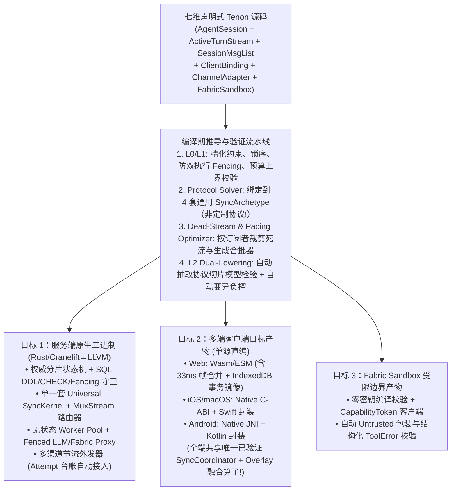

# 07 — 重思 `dast-os-kernel`：全新架构提案与七维声明式响应式数据流编译

> **探讨背景**：结合 [`dast-os-kernel`](../../../dast.ai/dast-os-kernel/README.md) 的完整需求（多渠道、多服务器高可用、Fabric 沙箱、多端流式显示、防多 Worker 并发执行同一 Agent、Interrupt / Steering / Followup、刷新与增量同步），本篇回答两个更深层的问题：
> 1. **`dast-os-kernel` 原有架构本身是否最优？哪些复杂度是本质的，哪些是可以靠全新架构 + 语言原语直接消解的？**
> 2. **如果我们希望开发者只声明“依赖、关系、操作影响”等极简核心要素，还需要补充哪些正交因素，才能让编译器直接推导出高性能、高可靠、高可用的分布式服务端与前端可执行代码？**

---

## 1. 诚实反思 `dast-os-kernel`：本质真理 vs 偶然复杂度

在审视 `dast-os-kernel`（227 轮审计、17 个 TLA+ 模型、20 项 Interrupt/Stop/Cancel 门禁）后，必须严格区分两类复杂度：

### 1.1 必须保留的 5 条本质真理（物理宇宙定律，换架构也躲不掉）
1. **状态正交三轴**（`Intent × Authority/Fact × Execution/Observed`），禁止大杂烩 `status` 枚举；
2. **外部副作用的不可逆性与 `Unknown` 事实**：只要跨过网络调用外部 LLM/OAuth/IM/OS，超时崩溃必然出现“不确定远端是否已生效”，因此 **Admit → Execute → Fact Receipt → Apply/Compensate** 不可省略；
3. **写路径 Append 化 + 易失热流与持久历史分离**：高吞吐 LLM Token 绝不能逐帧落盘或反复重写整个 Session Blob；
4. **单连接多路复用 + 按职责能力演进（`required ⊆ supported`）**：防连接爆炸与版本锁死；
5. **Fabric 沙箱零密钥 + `untrusted` 外部数据隔离**。

### 1.2 可以被全新架构大幅消解的 4 大偶然复杂度

原 `dast-os-kernel` 之所以极其沉重，根源在于它采用了 **“共享关系表 + 多无状态节点直接争抢行锁 + 原地修改状态”** 的传统架构，被迫衍生出大量防御补丁：

| 原设计痛点 | 产生的沉重负担 | 全新架构的根治方案 |
| --- | --- | --- |
| **1. 共享 SQL 表多写者直接争锁** | 6 级物理锁序、足迹变化回滚重锁、5 张人工调度表（`Dirty`/`Due`/`Outbox`/`Attempts`/`Receipts`）、SQL Begin 与本机安装两阶段竞态（BE68） | **分片单写者确定性实体（Partitioned Single-Writer Entity）+ 存储/代理双端硬 Fencing Epoch**：每个 Session（或权威闭包）的写请求串行汇聚到当前 Epoch Owner，外部仅通过有序事件邮箱交互 |
| **2. 原地覆盖式修改执行上下文** | Interrupt / Stop / Cancel / Fork / Reset 之间互相踩踏，需要 20 项 MC 门禁处理“未消费输入强插不能继承零闭合祖先”“迟到旧工具回执不能混入新轮” | **不可变分支日志（Branch-Aware Turn DAG）**：`Interrupt`、`Fork`、`ForkAt`、`Reset` 统一退化为同一个纯数据操作——**从最后一个已闭合 Turn 原子创建新 `BranchId` 并推进 `branch_epoch`**！旧分支迟到 Receipt 携带旧 `branch_epoch`，天然归入审计/补偿槽，绝不污染当前分支 |
| **3. 持久消息、排队输入、易失 Token 流、卡片状态手工拼装 6 层** | 服务端写投影、Gateway 写缓冲、前端四端手抄 `SyncCoordinator`、防闪烁/防重复气泡/丢尾自愈写满易错状态机 | **声明式增量数据流视图（Incremental Materialized Reactive Stream）**：把 `msg_list` 定义为 `CommittedTurns ⊕ ActiveTokenStream ⊕ QueuedInputs ⋈ VisibleCards` 上的声明式函数，由编译器自动生成增量融合与原子交接代码 |
| **4. 渠道限流与前端降耗全靠手写胶水** | Web/iOS/Android 手写帧合并、Telegram/Slack/飞书各自手写消息编辑节流与超长切分 | **声明式订阅节奏算子（Declarative Pacing & Coalescing）**：在订阅声明中直接写 `coalesce_by_frame(33ms)` / `throttle_trailing(1200ms)` / `FinalTurnOnly`，编译器直接编成目标端零分配可执行代码并做死流裁剪 |

---

## 2. 完备性回答：只定义“依赖、关系、操作影响”够不够？—— 七维完备声明模型

要让编译器**不靠猜测**就能从声明式源码直接推导出**高性能、高可靠、高可用**的分布式系统与多端代码，仅声明“依赖、关系、操作影响”是不够的（它们只能决定**功能正确性**，决定不了**物理分布、容错与性能边界**）。

经过第一性原理归约，完整推导需要恰好 **7 个正交声明维度**（且 5–7 维大多提供分层默认值，业务模块只需声明差异）：

| 维度 | 声明什么 | 缺少它会导致什么不可推导？ |
| --- | --- | --- |
| **① 实体与精化不变量** | 状态结构、正交三轴、值域/跨字段约束（如 `Date`、`Amount > 0`、Turn DAG） | 无法静态消除校验、无法推导存储 Schema 与演化残差域 |
| **② 关系与一致性归属** | 实体间关系（1:1 / 1:N / 树）、**权威分片键（Partition Key / AuthorityHome）**、外部写入冲突域（`ConflictKey`） | 编译器不知道哪些状态必须强一致串行（如防双 Worker 执行、父子共额），哪些可以水平扩展或异步解耦 |
| **③ 数据流与响应式依赖** | 视图/下游如何从上游日志、状态与实时流增量派生（如 `msg_list` 依赖 `turns` + `ActiveTurnStream` + `cards`） | 无法自动生成增量维护（IVM）、精确脏传播与无闪烁流式叠加交接 |
| **④ 操作影响与效应类别** | 操作修改哪些轴，属于 `Pure` / `IdempotentDesired` / `NonIdempotentAttempt` / `VolatileEmit`，以及失败重试安全证明 | 无法区分“可随时重算的投影”“可幂等覆盖的闹钟”和“绝不能盲重发的旋转 OAuth/扣费/外部消息” |
| **⑤ 持久性与恢复契约** | `AuthoritativeDurable`（强一致落盘）/ `ReconstructibleView`（可重建投影）/ `VolatileStream(heal_from)`（内存易失+自愈源）/ `ImmutableBlob` | 缺少它，编译器无法决定“绝不逐 Token 写库”还是“绝不把 Receipt 放内存” |
| **⑥ 物理放置与信任边界** | 节点角色：`Authority` / `Worker` / `FabricSandbox(zero-secret)` / `Gateway` / `Client(Web/Native)` / `Channel`；数据是否 `Untrusted` | 无法自动切分编译目标、无法自动在边界生成零密钥 `authedFetch` 代理与 `Untrusted` 围栏 |
| **⑦ 性能、背压与时间预算** | 窗口上限（50 条/4 MiB）、帧合并 `coalesce_by_frame(33ms)`、节流 `throttle_trailing(1200ms)`、慢端策略 `DropAndResync`、`valid_until`、`idle_suspend(30m)` | 缺少它，编译器无法推导分页 fence、重置 floor、前端 60fps 防抖渲染、IM 渠道防封号限频和内存上界 |

---

## 3. 全新设计全景：用 Tenon 七维声明直接表达 `dast-os` 核心

### 3.1 高可用防双执行 + Branch-Aware Interrupt / Steering / Followup

通过 **分片单写者实体 + 双端硬 Fencing + 不可变 Turn DAG**，把原本跨 5 张表、20 个门禁的会话控制压缩成极其干净、可证明的声明：

```tenon
// 权威实体按 session_id 分片：同一时刻全球至多一个合法 Epoch 拥有执行与提交权
@partition(key = self.id, consistency = LinearizablePerShard, fencing = StorageAndProxyEpoch)
reconciled entity AgentSession {
    intent {
        conv_gen:        MonotonicU64,
        active_branch:   BranchId,
        // 三种输入语义在数据结构上彻底正交，零竞态混淆：
        steering_inbox:  BoundedQueue[SteerMsg, 64],    // P0: 当前 Run 下一个安全点注入
        followup_inbox:  BoundedQueue[UserMsg, 64],     // P1: 当前 Run 终结后开启下一 Run
    }

    authority {
        model:           ModelSpec,
        grants:          Set[GrantProof],
        budget:          Ref[BudgetPermit],
        sandbox_uid:     Option[RuntimeUID],
    }

    // 不可变追加 Turn DAG：每次提交 O(1) Append，Interrupt / Fork / Reset 均是 O(1) 切分支！
    log turns: AppendDAG[CommittedTurn] {
        parent:          Option[TurnId],
        branch:          BranchId,
        conv_gen:        U64,
        run_id:          RunId,
        closed:          Bool,                          // 仅闭合轮次可作为新分支的祖先！
    }

    observed {
        phase:           Idle | Runnable | Executing(exec_epoch: MonotonicU64) | Waiting(WaitSet),
        active_stream:   Option[StreamLineage],         // (conv_gen, active_branch, run_id, stream_id)
    }

    // 核心全局安全不变量（由 L1 + L2 强制验证）
    invariant single_active_executor:
        // 任何外部代理（LLM / Fabric）与存储提交必须校验 epoch == self.observed.exec_epoch
        forall w1, w2: Worker => can_commit(w1, self) && can_commit(w2, self) => w1.epoch == w2.epoch

    // 1. 强打断（Interrupt）：不抢普通队列配额，不原地破坏 Inflight！
    //    直接从当前分支最后一个 closed == true 的 Turn 开新分支 + 推进 epoch，旧 Worker 立即被双端硬拦截！
    command Interrupt(cmd_id: CommandId, msg: UserMsg) -> InterruptReceipt
        idempotent_by cmd_id
        requires self.observed.phase != Idle            // 空闲会话走普通 Send，防迟到打断错建 Run
    {
        let base_turn = self.turns.last_closed_on(self.intent.active_branch)
        let new_branch = BranchId.next(parent = base_turn)
        self.intent.active_branch = new_branch
        self.intent.steering_inbox.supersede_all()      // 仅作废旧分支未消费 steering，保留 followup！
        self.observed.advance_epoch_and_abort_active()  // 立即向 LLM/Fabric Proxy 撤销旧 Epoch 资格
        // 旧分支已发出的外部 Attempt 事实继续走独立 Receipt 通道结算/补偿，绝不混入 new_branch！
        self.turns.append_input(branch = new_branch, parent = base_turn, msg = msg)
    }

    // 2. Steering（安全点转向）：不打断当前正在进行的工具/模型调用，在下一个安全点折叠进上下文
    command Steer(cmd_id: CommandId, msg: SteerMsg) -> Ack
        idempotent_by cmd_id
    {
        self.intent.steering_inbox.push(msg)
    }

    // 3. Followup（轮末跟进）：持久排队，绝不干扰当前 Run，当前 Run 闭合后自动触发下一 Run
    command Followup(cmd_id: CommandId, msg: UserMsg) -> Ack
        idempotent_by cmd_id
    {
        self.intent.followup_inbox.push(msg)
    }
}
```

**如何绝对保证多服务器高可用下“一个 Agent 不被两个 Worker 同时执行”？**
1. **领取与续租走集群无状态 Worker Pool**：任意 Worker 故障、SIGKILL 或滚动升级，健康检查/租约超时后新 Worker 从权威分片领取执行切片，权威分片原子推进 `exec_epoch = E + 1`；
2. **双端硬 Fencing（Storage + Effect Proxy）**：编译器自动为 `exec_epoch` 生成两道硬闸门：
   - **存储闸门**：所有检查点、步骤推进与完成提交携带 `epoch`，权威分片硬件/事务级拒绝 `epoch < current_epoch`；
   - **代理闸门（LLM Proxy & Fabric Proxy）**：Worker 绝不直连外部 Provider 或无防护执行沙箱，每次调用必须携带签名令牌 `(session_id, branch_id, run_id, exec_epoch)`；分片推进 `exec_epoch` 时同步广播撤销/代理短时校验，旧 Worker 哪怕网络分区后醒来也无法发起新的付费模型调用或沙箱写入！
3. **迟到事实与当前分支解耦**：旧 Worker 在失租前已发出的外部调用若迟到返回，携带原 `(effect_id, old_branch_id)` 经 `ReceiptPort` 写入事实与计费账本；因为 `old_branch_id != active_branch`，绝不会污染新分支的 `msg_list` 和上下文！

---

### 3.2 建立 `LLM 流式输出` → `msg_list` → `多端/多渠道显示` 的端到端声明式依赖

下面的声明完整回答了**“`msg_list` 是如何得来的、如何把 LLM 流式与 `msg_list` 建立依赖、前端流式显示与 Debounce 以及多渠道订阅如何零胶水编译”**：

```tenon
// Step 1: 声明易失热流（零 DB 写，绑定精确谱系，丢尾可自愈）
@stream(durability = Volatile, db_writes = 0, slow_consumer = DropAndResync)
stream ActiveTurnStream(sid: SessionId) -> Delta[PartDelta] {
    source:     llm_proxy.token_stream(sid) | fabric_proxy.tool_progress(sid),
    lineage:    (conv_gen, branch_id, run_id, stream_id),
    ordered_by: delta_seq: MonotonicU64,
    // 服务端内存增量折叠为热前缀（供新连接/重连无缝拼接，不写权威 DB）
    prefix:     fold(TurnDraft.empty(), apply_part_delta)
                    with optional_best_effort_snap(debounce = 500ms),
}

// Step 2: 声明式定义 `msg_list` —— 持久分支历史 ⊕ 易失热流覆盖层 ⊕ 排队输入 ⋈ 可见卡片
// 编译器自动推导出增量数据流维护算子（IVM）和无缝流→持久交接逻辑！
@sync_view("session.msg_list")
reactive view SessionMsgList(sid: SessionId)
    scope  = (deploy_id, principal, sid)
    bounds = { window: 50 turns, max_frame: 4 MiB, offline_recovery: BoundedReset }
{
    let s = AgentSession(sid)

    // (1) 持久层：仅沿当前 conv_gen + active_branch 投影最近 50 轮（O(1) 追加，切分支自动刷新）
    let history = s.turns
        .branch_chain(s.intent.conv_gen, s.intent.active_branch)
        .tail(50)
        .map(project_committed_msg)

    // (2) 易失流层：把 ActiveTurnStream 实时叠加为最后一条“正在生成”气泡
    //     编译器利用 run_id 做关系反连接（Anti-Join）：
    //     一旦对应 run_id 的 CommittedTurn 进入 history，overlay 原子消失，零闪烁、零重复！
    let live_bubble = ActiveTurnStream(sid)
        .match_lineage(s.observed.active_stream)
        .anti_join(history, on = run_id)
        .map(project_streaming_bubble)

    // (3) 排队层：未消费的 followup/steering（按 clientMessageId 去重，禁止按文本去重）
    let queued = (s.intent.steering_inbox ++ s.intent.followup_inbox)
        .map(project_queued_msg)

    // (4) 动态卡片层：仅对当前视口可见消息挂载的 CardRef 批量订阅实时状态
    let live_cards = extract_card_refs(history)
        .viewport_scoped()
        .batch_join(ObjectReadView)

    output {
        timeline: history ++ live_bubble ++ queued,
        cards:    live_cards,
        run_bar:  project_run_status(s.observed.phase, s.authority.budget),
    }
}
```

#### Step 3：前端流式显示 + Debounce + 多渠道订阅 —— 声明式直编为目标可执行代码！

```tenon
// A. 多端 UI 订阅者（直接编译为 WebAssembly/JS、Swift、Kotlin 原生模块，无需中间手写适配层！）
@target_artifact(Web = "wasm-esm", iOS = "swift-xcframework", Android = "kotlin-jni", Desktop = "native")
client_binding SessionChatStore(sid: SessionId) {
    bind view = SessionMsgList(sid)
    // 声明式降耗与流式刷新策略：编译器直接生成定时合并器 + 差分 Patch 发射器！
    pacing {
        // LLM Token 增量按 33ms（~30fps）在内存中合并字符串，避免每来 1 个 Token 就触发一次 React/UI 重绘！
        live_bubble.delta:  coalesce_window(33ms, reducer = concat_text_by_part),
        // 卡片批量读取防抖 100ms，快速滚动时取消过期视口拉取
        cards:              debounce(100ms, cancel_superseded = true),
        // 关键状态（Run 结束、错误、需人类批准卡片、Interrupt 生效）零延迟直通！
        run_bar | history:  immediate,
    }
    local_storage {
        // 编译器静态确保：仅 history 与 checkpoint 同事务写入 IndexedDB/SQLite；
        // live_bubble 永远只驻留内存，零磁盘写放大！
        persist:            [history, checkpoint],
        volatile_in_memory: [live_bubble, run_bar],
    }
}

// B. 外部 IM 多渠道适配器（Slack / 飞书 / Telegram / 微信 / Email）
// 全部复用同一份 SessionMsgList，编译器按渠道能力画像自动生成节流与剪枝代码！
@channel_binding("feishu",   rate_limit = 1 edit / 1000ms, max_bytes = 30 KiB, supports_edit = true)
@channel_binding("telegram", rate_limit = 1 edit / 1200ms, max_bytes = 4 KiB,  supports_edit = true)
@channel_binding("email",    supports_edit = false)
channel_adapter OutboundChannelSink(ch: ChannelRef, sid: SessionId) {
    bind view = SessionMsgList(sid)
    pacing {
        // 编译期静态分支特化：
        // • 对飞书/Telegram：生成尾随节流器（每 1.0–1.2s 编辑同一条消息）+ 超限自动续发新消息；
        // • 对 Email（supports_edit == false）：编译器静态裁剪掉 live_bubble 订阅，零 Token 转发开销！
        comptime if ch.supports_edit {
            live_bubble.delta: throttle_trailing(ch.rate_limit, split_at = ch.max_bytes),
            history:           immediate_finalize_edit,
        } else {
            live_bubble:       disabled,          // 死流消除：Gateway 不为 Email 订阅 Token Topic！
            history:           immediate_send,
        }
    }
    // 渠道外发一律自动包裹 Attempt 协议（幂等 delivery_id），崩溃重启绝不重发消息！
    delivery_guarantee: AtMostOnceWithAttempt(idempotency = (ch.id, msg.id, chunk_index))
}
```

### 3.3 Fabric Sandbox 与外部世界的一体化声明

```tenon
@partition(key = self.uid, fencing = StorageAndProxyEpoch)
reconciled entity FabricSandbox
    conflict_key = self.uid  // Exec 与 Suspend/Resume/Rebuild/Destroy 在编译期强制互斥！
{
    intent    { desired_state: Running | Suspended | Destroyed, image_digest: VerifiedDigest }
    authority { seed_sha256: Digest, user_layer_rev: MonotonicU64, workspace_rev: MonotonicU64 }
    observed  { actual_state: SandboxPhase, active_execs: Set[AttemptId], last_used_at: MonotonicTime }

    // 声明式自动回收：编译器自动生成 DueIndex(uid, max(last_used_at + 30m, busy_until))，零全表扫描！
    temporal auto_suspend when self.observed.active_execs.is_empty()
                          at   self.observed.last_used_at + 30.minutes
                          =>   transition(desired_state = Suspended)

    // 安全边界声明：沙箱进程零密钥，一切外部调用经宿主受控代理，响应强制打 Untrusted 污点！
    @sandbox_boundary(secrets = Forbidden, outbound = HostProxy(authedFetch))
    effect ExecCommand(cmd: CommandSpec) -> Result[Untrusted[ExecOutput], ToolError]
        requires self.observed.actual_state == Running
        // 编译器静态检查：取消时必须按 ProcessGroup 级联清理，且 Suspended 时允许只读/文件 API 不唤醒 Pod！
}
```

---

## 4. 编译器如何直接生成可执行目标（不靠一大堆碎片化定制协议）？



### 为什么这实现了“核心极简、模块零胶水、直出高性能可执行码”？

1. **没有中间玩具胶水，直接编译为目标机器码/Wasm**：
   - 前端 `coalesce_window(33ms)` 和 `anti_join(history, on = run_id)` 并不是靠运行时重型解释器在浏览器里算 SQL，而是由 Tenon 编译器编译成**极简、零分配的增量差分状态机（Wasm/Native）**：来一个 Token 增量只追加进当前 `PartBuffer`，定时器 33ms 吐出一次最小 UI Patch（仅含变化的 `(msg_id, part_id, text_slice)`），UI 框架（React/SwiftUI/Compose）直接精准局部重绘！
2. **极简微内核不随模块数膨胀**：
   - 无论你接入 10 个 IM 渠道（飞书/Slack/Telegram/Discord/微信/邮件…）、4 种客户端、还是 20 种业务视图，底层运行的永远只有 **1 套权威分片引擎 + 1 套 Fencing Proxy 协议 + 1 套多路复用 `MuxStream` + 4 个可扩展 `SyncArchetype` + 1 套单源编译的 `SyncCoordinator`**。
3. **高可靠与高可用内生于架构而非事后补丁**：
   - 多服务器水平扩展：Gateway 无状态、Worker 无状态、Authority 按分片水平扩展、跨节点通过热流总线扇出 + 持久投影兜底；
   - 防双 Worker 执行：不是靠祈祷租约不飘，而是靠**存储 + Proxy 双端硬 `exec_epoch` Fencing**；
   - 中断/转向/跟进零竞态：因为 Turn 是不可变追加 DAG，打断即是 $O(1)$ 开新分支，旧分支迟到事实永远隔离在旧 `branch_id` 下安全结算。
