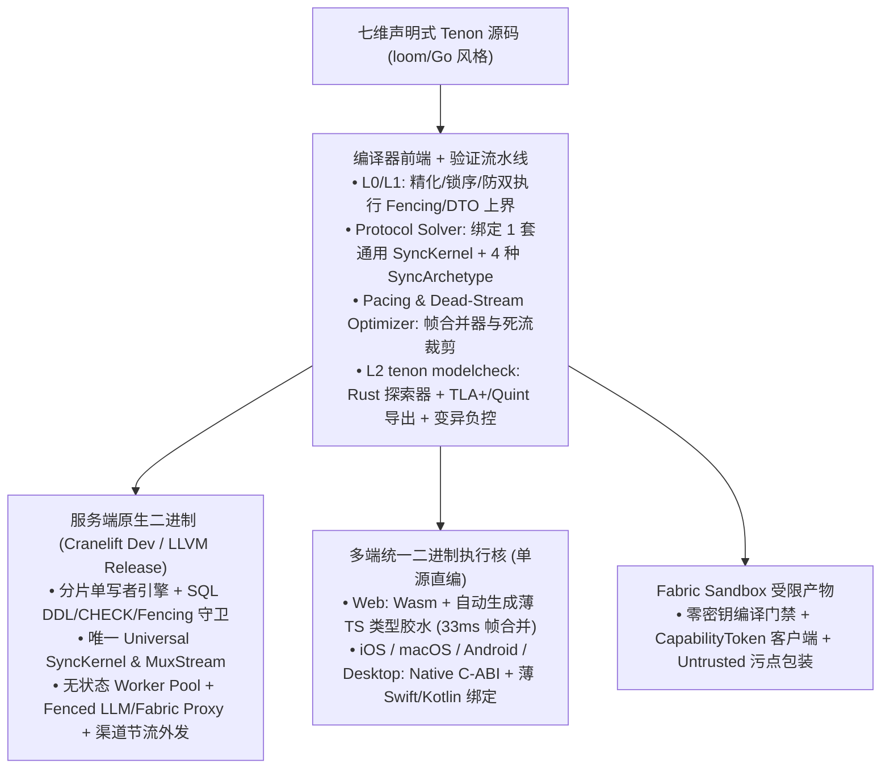

# 07 — 重思 `dast-os-kernel`：全新架构提案与七维声明式响应式数据流编译

> **架构依据**：采用 [ADR-0001 (D02, D04, D07, D08, D10, D12)](adr/0001-architecture-decisions.md) 定稿方案与统一 **`loom/Go` 简洁语法**，展示如何在极简通用核心 + 标准库可验证协议模板之上，以全新分布式架构与声明式响应式数据流实现 `dast-os` 全栈（多渠道、多服务器高可用、Fabric 沙箱、防多 Worker 并发执行、Interrupt/Steering/Followup、`LLM 流 → msg_list` 端到端依赖与多端 Wasm/Native 防抖渲染）。

---

## 1. 诚实反思 `dast-os-kernel`：本质真理 vs 偶然复杂度

### 1.1 必须保留的 5 条本质真理
1. **状态正交三轴**（`Intent × Authority × Observed`），禁混合 `status` 枚举；
2. **外部副作用的 `Unknown` 不可逆性**：Admit → Execute → Fact Receipt → Apply/Compensate 双围栏；
3. **写路径 Append 化 + 易失热流与持久历史分离**；
4. **单连接多路复用 + 按职责能力子集少版本化**；
5. **Fabric 沙箱零密钥 + `Untrusted` 外部数据隔离**。

### 1.2 全新架构彻底消解的 4 大偶然复杂度（[ADR-0001 D07](adr/0001-architecture-decisions.md)）

| 原设计痛点（共享 SQL 表多写者抢锁） | 产生的沉重负担 | 全新架构根治方案 |
| --- | --- | --- |
| **1. 多写者直接争抢 SQL 行锁** | 6 级锁序、足迹变化重锁、5 张人工调度表、SQL Begin 与本机安装两阶段竞态 | **分片单写者确定性实体 + 存储/代理双端硬 Fencing Epoch**（底层 SQLite / PG / Raft-KV 可插拔） |
| **2. 原地覆盖修改执行上下文** | Interrupt / Stop / Cancel / Fork / Reset 互相踩踏，需 20 项 MC 门禁补丁 | **不可变分支日志（Branch-Aware Turn DAG）**：`Interrupt` / `Fork` / `ForkAt` / `Reset` 统一为从最近 `closed == true` 轮次 $O(1)$ 开新 `BranchId` + 推进 `exec_epoch` |
| **3. 持久历史、排队输入、易失 Token 流、卡片手工拼装 6 层** | 服务端/Gateway/四端手抄状态机，易闪烁、重复气泡、丢尾卡死 | **声明式增量响应式数据流（IVM + Anti-Join Volatile Overlay）**：`msg_list` 单源声明，流提交瞬间原子撤销覆盖层 |
| **4. 多端防抖与多渠道限流全靠手写胶水** | Web/iOS/Android/飞书/Telegram 各自手搓合批、编辑节流与超长切分 | **声明式节奏算子（`coalesce_window` / `debounce` / `throttle_trailing`）**：单源直编 Wasm/Native 可执行码 + 编译期死流消除 |

---

## 2. 七维完备声明模型：只写“依赖、关系、操作影响”还差什么？

仅声明“依赖、关系、操作影响”只能决定**功能语义**；要让编译器无猜测地推导并验证出**高性能、高可靠、高可用**的分布式实现，最小正交声明空间为 **7 维**：

| 维度 | 声明内容 | 决定编译器推导什么 |
| --- | --- | --- |
| **① 实体与精化不变量** | 三轴结构、值域/跨字段精化（`Date`、`Amount > 0`）、Turn DAG | 静态消除校验、Schema 与演化残差域 |
| **② 关系与一致性归属** | 1:1 / 1:N / 树、**权威分片键（Partition Key）**、冲突域 `ConflictKey` | 哪些状态强一致串行（防双执行、父子共额），哪些水平扩展 |
| **③ 响应式依赖与派生流** | `msg_list` 如何从 `turns ⊕ ActiveTurnStream ⊕ queued ⋈ visible_cards` 派生 | 增量维护（IVM）、精确脏传播、Anti-Join 无闪烁交接 |
| **④ 操作影响与效应类别** | 修改的轴、`Pure` / `IdempotentDesired` / `NonIdempotentAttempt` / `VolatileEmit` | 区分可重算投影、幂等期望与绝不可盲重发的旋转凭据/扣费/外发 |
| **⑤ 持久性与恢复契约** | `AuthoritativeDurable` / `ReconstructibleView` / `VolatileStream(heal_from)` / `ImmutableBlob` | 绝不逐 Token 写库，绝不把 Receipt 当 UI 缓存 TTL 回收 |
| **⑥ 物理放置与信任边界** | `Authority` / `Worker` / `FabricSandbox(zero-secret)` / `Gateway` / `Client` / `Channel`、`Untrusted` | 自动切分编译目标、边界插入 `authedFetch` 零密钥代理与污点围栏 |
| **⑦ 性能、背压与时间预算** | 窗口上限、`coalesce_window(33ms)`、`debounce(100ms)`、`throttle_trailing(1200ms)`、`DropAndResync`、`valid_until`、`idle_suspend(30m)` | 分页 fence、重置 floor、前端 30fps 帧合并、IM 防封号限频与内存上界 |

---

## 3. 全新架构声明式全景（`loom/Go` 定稿语法）

### 3.1 防双 Worker 执行 + Branch-Aware Interrupt / Steering / Followup

```tenon
@partition(key = self.id, consistency = LinearizablePerShard, fencing = StorageAndProxyEpoch)
@reconciled(lock_class = KernelLocks.L3_Control)
pub record AgentSession {
    @axis(Intent) {
        conv_gen       MonotonicU64
        active_branch  BranchId
        steering_inbox BoundedQueue[SteerMsg, 64]     // P0: 当前 Run 下一安全点折叠注入
        followup_inbox BoundedQueue[UserMsg, 64]      // P1: 当前 Run 闭合后开启下一 Run
    }

    @axis(Authority) {
        model          ModelSpec
        grants         Set[GrantProof]
        budget         Ref[BudgetPermit]
        sandbox_uid    Option[RuntimeUID]
    }

    // 不可变追加 Turn DAG：每次提交 O(1) Append；Interrupt / Fork / Reset 统一为 O(1) 切分支！
    @append_dag(key = (conv_gen, branch, turn_seq))
    turns AppendDAG[CommittedTurn] {
        parent   Option[TurnId]
        branch   BranchId
        conv_gen U64
        run_id   RunId
        closed   Bool                                 // 仅闭合轮次可作新分支祖先
    }

    @axis(Observed) {
        phase         SessionPhase                    // Idle | Runnable | Executing(exec_epoch) | Waiting(WaitSet)
        active_stream Option[StreamLineage]           // (conv_gen, active_branch, run_id, stream_id)
    }

    // 全局安全不变量（由 L1 + tenon modelcheck 双引擎验证）
    invariant single_active_executor:
        forall w1 Worker, w2 Worker =>
            can_commit(w1, self) && can_commit(w2, self) => w1.epoch == w2.epoch

    // 1. 强打断（Interrupt）：不占普通队列配额，从最近闭合 Turn 开新分支 + 双端撤销旧 Epoch！
    @command(idempotent_by = cmd_id)
    pub fn interrupt(inout self, cmd_id CommandId, msg UserMsg) InterruptReceipt
        requires self.phase != SessionPhase.Idle
    {
        let base_turn  = self.turns.last_closed_on(self.active_branch)
        let new_branch = BranchId.next(base_turn)
        self.active_branch = new_branch
        self.steering_inbox.supersede_all()           // 仅作废旧分支未消费 steering，保留 followup！
        self.advance_epoch_and_abort_active()         // 同步推进 exec_epoch，存储与 LLM/Fabric Proxy 硬拦旧 Worker！
        // 旧分支已发出的外部 Attempt 经 ReceiptPort 独立落账与补偿，绝不污染 new_branch！
        self.turns.append_input(new_branch, base_turn, msg)
    }

    // 2. Steering（安全点转向）
    @command(idempotent_by = cmd_id)
    pub fn steer(inout self, cmd_id CommandId, msg SteerMsg) Ack {
        self.steering_inbox.push(msg)
    }

    // 3. Followup（轮末跟进）
    @command(idempotent_by = cmd_id)
    pub fn followup(inout self, cmd_id CommandId, msg UserMsg) Ack {
        self.followup_inbox.push(msg)
    }
}
```

### 3.2 `LLM 流式` → `msg_list`（Anti-Join 无闪烁交接）→ `多端 Wasm/Native & 多渠道`

```tenon
// Step 1: 易失热流（零 DB 写，绑定精确谱系，丢尾可自愈）
@stream(durability = Volatile, db_writes = 0, slow_consumer = DropAndResync)
stream ActiveTurnStream(sid SessionId) Delta[PartDelta] {
    source     = llm_proxy.token_stream(sid) | fabric_proxy.tool_progress(sid)
    lineage    = (conv_gen, branch_id, run_id, stream_id)
    ordered_by = delta_seq
    prefix     = fold(TurnDraft.empty(), apply_part_delta)
                     with best_effort_snap(debounce = 500ms)
}

// Step 2: 声明式定义 `msg_list` —— 持久分支历史 ⊕ 易失覆盖层 ⊕ 排队输入 ⋈ 可见卡片
@sync_view("session.msg_list")
reactive view SessionMsgList(sid SessionId)
    scope  = (deploy_id, principal, sid)
    bounds = { window = 50 turns, max_frame = 4 MiB, offline_recovery = BoundedReset }
{
    let s = AgentSession(sid)

    let history = s.turns
        .branch_chain(s.conv_gen, s.active_branch)
        .tail(50)
        .map(project_committed_msg)

    // 关键 Anti-Join：对应 run_id 的 CommittedTurn 落盘瞬间，live_bubble 原子撤销，零闪烁、零重复气泡！
    let live_bubble = ActiveTurnStream(sid)
        .match_lineage(s.active_stream)
        .anti_join(history, on = run_id)
        .map(project_streaming_bubble)

    let queued = (s.steering_inbox ++ s.followup_inbox)
        .map(project_queued_msg)

    let live_cards = extract_card_refs(history)
        .viewport_scoped()
        .batch_join(ObjectReadView)

    output SessionMsgListDTO {
        timeline = history ++ live_bubble ++ queued
        cards    = live_cards
        run_bar  = project_run_status(s.phase, s.budget)
    }
}

// Step 3a: 多端前端执行核 —— 单源编译为 Web Wasm (+薄 TS) 与 Native C-ABI (+薄 Swift/Kotlin)
@client_binding(web = WasmThinTS, native = StaticCAbiSwiftKotlin)
subscriber SessionChatStore(sid SessionId) {
    bind view = SessionMsgList(sid)
    pacing {
        // 33ms (~30fps) 在 Wasm/Native 内部零分配合批文本，大幅摊薄跨边界拷贝与 UI 重绘开销
        live_bubble.delta = coalesce_window(33ms, concat_text_by_part)
        cards             = debounce(100ms, cancel_superseded = true)
        run_bar | history = immediate                 // 终态/错误/待批准卡片零延迟直通！
    }
    local_storage {
        persist            = [history, checkpoint]    // 同事务写 IndexedDB / SQLite
        volatile_in_memory = [live_bubble, run_bar]   // 编译器静态禁止逐 Token 落盘
    }
}

// Step 3b: 外部 IM 多渠道适配器 —— 复用同一 SessionMsgList + 编译期死流消除！
@channel_binding("feishu",   rate_limit = 1 edit / 1000ms, max_bytes = 30 KiB, supports_edit = true)
@channel_binding("telegram", rate_limit = 1 edit / 1200ms, max_bytes = 4 KiB,  supports_edit = true)
@channel_binding("email",    supports_edit = false)
subscriber OutboundChannelSink(ch ChannelRef, sid SessionId) {
    bind view = SessionMsgList(sid)
    pacing {
        comptime if ch.supports_edit {
            live_bubble.delta = throttle_trailing(ch.rate_limit, split_at = ch.max_bytes)
            history           = immediate_finalize_edit
        } else {
            live_bubble       = disabled              // 死流消除：Email 渠道零 Token 转发与订阅开销！
            history           = immediate_send
        }
    }
    delivery = AtMostOnceWithAttempt(idempotency = (ch.id, msg.id, chunk_index))
}
```

### 3.3 Fabric Sandbox 三层零密钥沙箱一体化

```tenon
@partition(key = self.uid, fencing = StorageAndProxyEpoch)
@reconciled(lock_class = KernelLocks.L4_Authority.Runtime, conflict_key = self.uid)
pub record FabricSandbox {
    @axis(Intent)    { desired_state SandboxDesired, image_digest VerifiedDigest }
    @axis(Authority) { seed_sha256 Digest, user_layer_rev MonotonicU64, workspace_rev MonotonicU64 }
    @axis(Observed)  { actual_state SandboxPhase, active_execs Set[AttemptId], last_used_at MonotonicTime }

    // 声明式空闲挂起：编译器自动维护 DueIndex(uid, max(last_used_at + 30m, busy_until))，零全表扫描！
    temporal auto_suspend when self.active_execs.is_empty()
                          at   self.last_used_at + 30.minutes
                          =>   transition(desired_state = SandboxDesired.Suspended)

    @sandbox_boundary(secrets = Forbidden, outbound = HostProxy(authedFetch))
    pub async fn exec_command(self, cmd CommandSpec) Result[Untrusted[ExecOutput], ToolError]
        requires self.actual_state == SandboxPhase.Running
}
```

---

## 4. 单源直编为多端目标可执行码（零割裂中间胶水）


